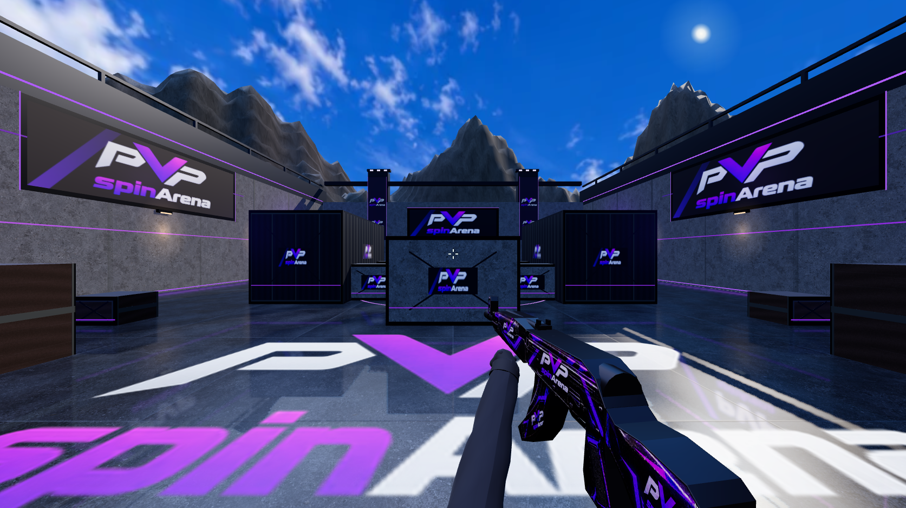

# FPS field polish — final-polish.png reference

This pass follows the user's sunny industrial arena reference: blue cloudy sky,
rocky surroundings, dark reflective concrete, warm wall fixtures, purple edge
lighting, large floor branding and a branded first-person AK.

The 1673 × 940 screenshot was captured by Chrome from the real Three.js renderer,
using the isolated local simulation fixture in `tests/e2e/helpers/fps-fixture.ts`.
It is not an image-generation output or proof of authenticated network play.
The fixture mounts the actual controller, collision simulation and weapon;
there is no new production mock route. The live app still uses its existing HUD.

## Changes and cost controls

- `arena-architecture.ts`: photographic sky panorama, textured/ridged terrain,
  warm wall-light pools, purple perimeter wash, daylight sprite and larger floor
  branding. Wall-light pools use shared baked texture cards rather than more
  dynamic lights. Repeated architecture remains instanced.
- `environment.ts`: new weathered floor albedo plus shared roughness and relief
  maps, with darker concrete and tuned roughness. Collision envelopes are unchanged.
- `floor-polish.ts`: one 512 × 512 planar reflection target, at most 20 captures
  per second while moving and one per second while stationary. Sustained slow
  frames lower it to 384 × 384 at most 10 captures per second. No extra shadow
  rendering in the reflection capture. Both players and the held weapon are
  excluded from reflection captures. Texture and render-target disposal is owned
  by the existing arena lifecycle.
- `renderer.ts` / `weapon.ts`: adjusted first-person stance, folded cloth sleeves,
  woven bump detail, cuffs, thumbs, dust-cover geometry, ribs and safety lever.
  The supplied AK side artwork still textures real volumetric geometry. The
  first-person stock is foreshortened for the shoulder pose. Existing input,
  prediction, recoil, reload and authoritative damage remain in place.

This is a browser-oriented procedural reconstruction. Mountains, hands and
weapon geometry still differ visibly from the reference's authored render;
this is not claimed to match CS:GO asset or animation fidelity.

## Assets and reproducibility

The **built-in imagegen tool** generated only the two material/background assets.
Both are saved in the repository; original PNG outputs remain in Codex's generated
images directory. They were converted to WebP for delivery:

- `public/fps/sky-final.webp`: 1774 × 887, 173,904 bytes.
- `public/fps/floor-final.webp`: 1024 × 1024, 429,770 bytes.

Sky prompt:

> Use case: photorealistic-natural. Asset type: 360-degree equirectangular skybox panorama for a real-time 3D browser FPS. A clear rich azure blue daytime sky with irregular natural scattered small white cumulus clouds and wispy high clouds, crisp photographic sky detail, realistic atmospheric blue gradient, no overexposure. Sky ONLY, no ground, no mountains, no buildings, no horizon objects, no text. No sun disk; the engine supplies the sun. Entire upper hemisphere is blue sky and clouds, lower hemisphere softly transitions to pale blue horizon haze. Proper equirectangular projection, horizontally seamless, image edge matches opposite edge. Wide 2:1 2048x1024 panorama. This is a material/background texture, not a screenshot or game scene.

Floor prompt:

> Use case: photorealistic-natural. Asset type: seamless tileable square diffuse/albedo texture for a real 3D industrial arena floor. Orthographic straight down, edge to edge weathered dark charcoal-gray concrete pavement with subtle fine aggregate, hairline cracks, worn polished patches, light scratches and irregular tiny pale mineral inclusions. Neutral cool gray, varied natural large-scale wear, restrained contrast, realistic photographic microdetail. Even unshadowed lighting. No actual reflections, no puddle highlights or directional sunlight baked in: the engine supplies lighting and wet reflections. No logos, text, stripes, objects, borders or perspective. Seamless all four edges. Square 1024x1024.

## Verification

616 unit tests passed. Nine Chrome tests passed covering both spawn views,
pointer lock, movement, crouching, jumping, automatic fire/release, reload,
surface impacts, opponent rendering, weapon artwork/geometry and lobby auth.
The moving-camera frame probe now holds the actual strafe key while sampling
120 requestAnimationFrame intervals at 1280 × 800: 13.9 ms median, 21.0 ms p95
in the final local run. These intervals are local workstation observations,
not GPU timings or guarantees of 60 FPS on every device.

Targeted lint, app and match-Worker TypeScript, and the production build pass.
This pass is local. Production and authenticated multiplayer validation remain
subject to the existing release gates in `FPS-OPERATIONS.md`.
