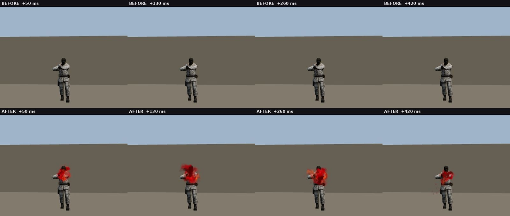
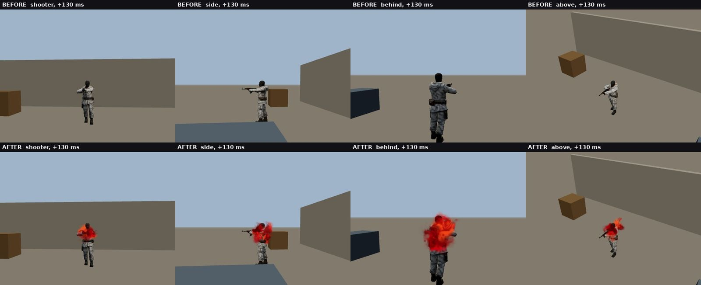
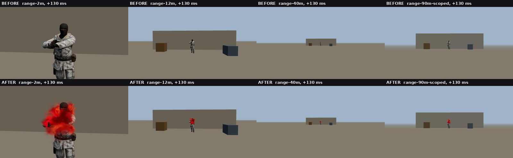
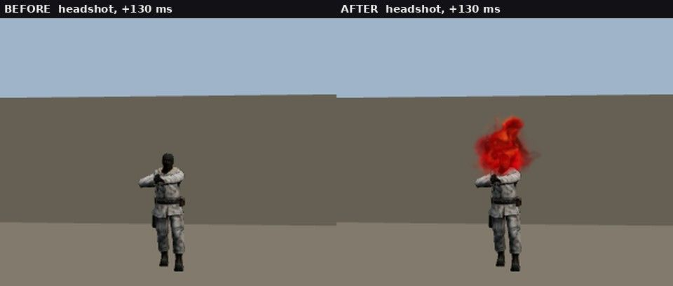
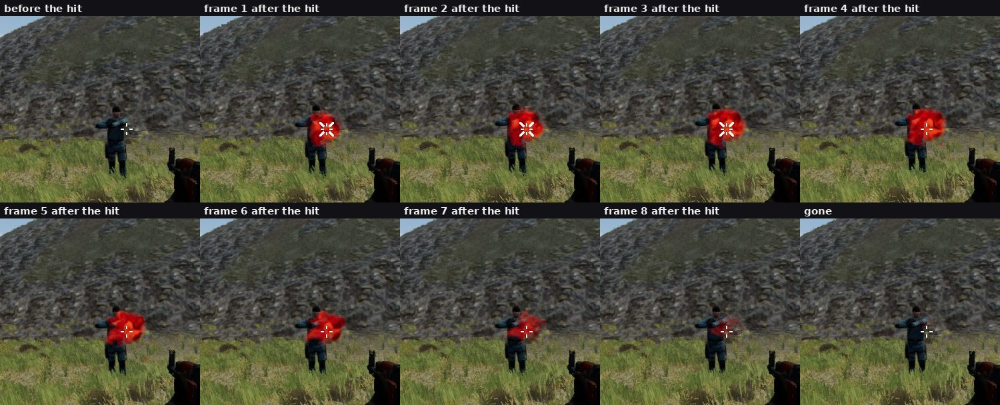
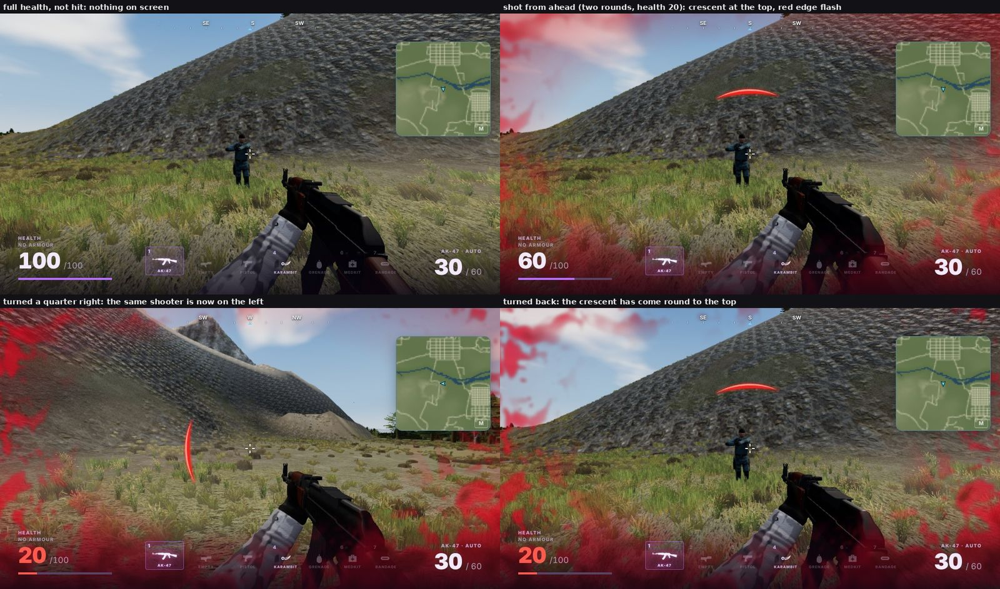
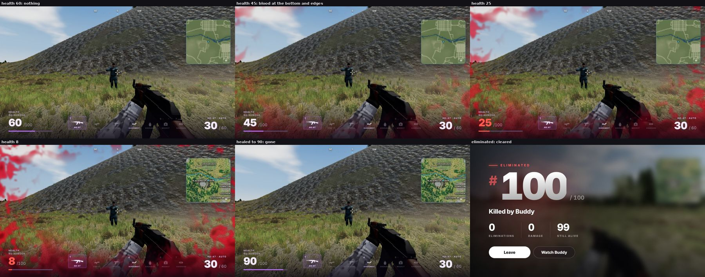
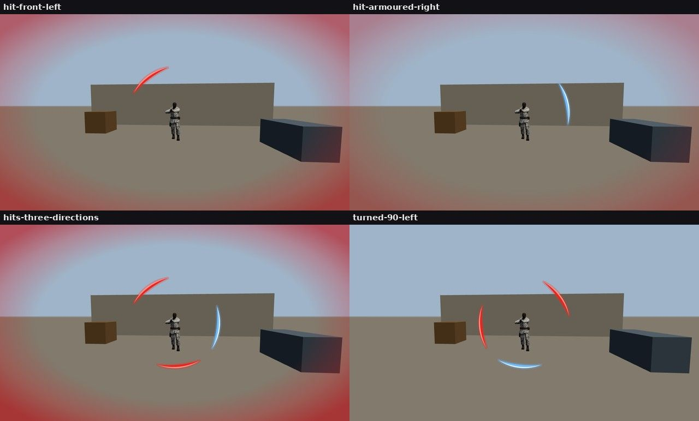
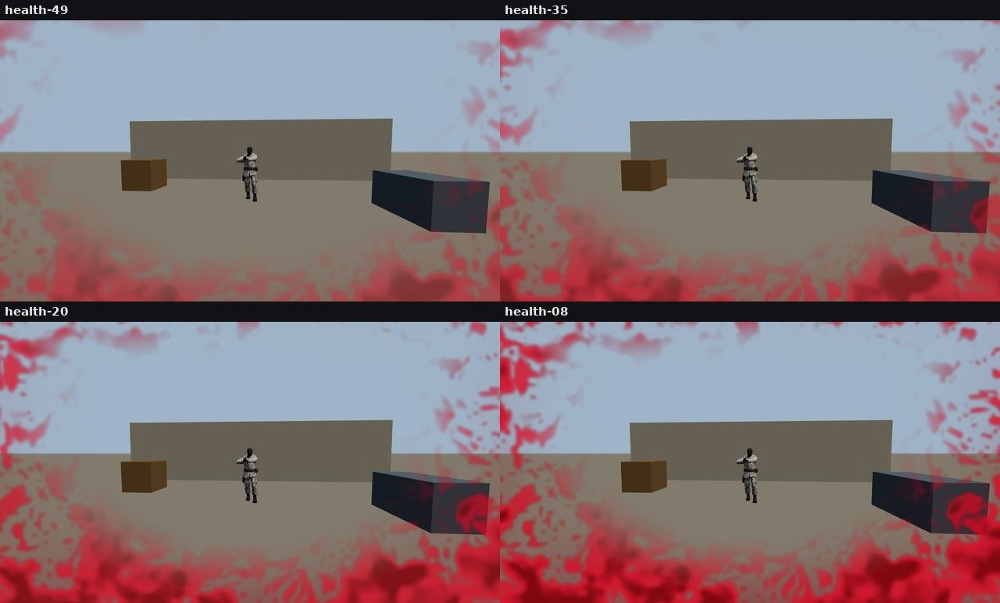

# Hit effects and incoming-damage feedback — 2026-11-27

Owner's request: a larger red mist/splash when a shot hits another character, in 1v1, 5v5 and the battle royale ("as realistic blood mist/cloud as possible", with a Warzone still as the reference); and in the battle royale a Warzone-style direction indicator for incoming damage, a red screen-edge flash, and a blood overlay under half health.

Nothing here decides a hit or changes health. Every effect is drawn from the server's own records (hit events, the kit's health). No server file is touched: site-only release, no Worker, database, secrets or feature flags.

## What changed

### Blood mist on a hit, all three modes

| | Before | After |
|---|---|---|
| 1v1, 5v5 | Eight 2.5 cm points for 0.23 s, from a pool of their own | The blood cloud |
| Battle royale | Nothing drawn on a hit | The same cloud |

The cloud (`src/lib/fps/flesh-mist.ts`, drawn by `impacts.ts`):

- **Pictures:** four sprites computed once from layered noise: two billows, a splash thrown out in beaded rays, a streaked wisp. Each has a density and a shade (deep red in the folds, orange-red where thin and lit).
- **Burst, 21 particles:** a splash at the wound (0.17 s), two wide thin veils, six dense billows (three back out of the wound toward the shooter, three carried on through the body) and twelve drops. A headshot's is a quarter larger, a leg's 15 % smaller. A shotgun's following pellets add 4 particles each, not a cloud each.
- **It wears away, it does not fade:** over a particle's life the density it needs to show rises, so thin parts go first and the cloud tears into strands. Densest for about a quarter of a second; the billows are gone in 0.45–0.65 s and the last thin veil by 0.8 s.
- **Where:** at the server's hit point, brought onto the body as it is drawn when the body has run on since (`anchorHit`). Never on the body the camera is in (your own, or the player you watch through).
- **From every side and range:** the cloud goes both ways from the wound, so it shows to the shooter, from the side and from behind. Its depth is taken 0.2–0.55 m toward the eye so it is not hidden inside the body. Sizes now follow the lens (a scope magnifies it with everything else), a far hit keeps a few pixels, and a point-blank puff is capped at 40 % of the screen's height and thins out as it reaches the camera.

### Incoming damage, battle royale (`src/lib/fps/damage-feedback.ts`)

- **Direction:** one crescent per shooter on a ring round the crosshair. It is placed every frame from where the shooter was when the hit landed and the camera as it is now, so it stays on the shooter as you turn. Up to six at once; a second hit from the same shooter renews theirs. Red when the hit took health; pale blue when the helmet or vest took it (the reference's arc is blue).
- **Edge flash:** a red vignette at the screen's edges for any damage, as strong as the damage, gone in about half a second. A fall, a blast or the gas shows it without a crescent.
- **Low health:** blood on the lens at the bottom and the edges from just under 50 %, stronger and reaching further in as health falls, full at 10 %, with a slow pulse under 25 % (not for players who ask for reduced motion). It eases off over about a second on healing. The middle of the screen (over a fifth of it, round the crosshair) is erased from the picture itself.
- **Resets:** cleared at once when you are eliminated (also while watching another player), on a new seat, and on coming back from the dead; removed from the page when the match is left.
- It replaces the old single arc (`.br-hurt`), which was fixed at the angle of the moment of the hit and showed one direction.

Low-health feedback and the direction indicator are in the battle royale only, as the request scoped them. `damage-feedback.ts` has no battle-royale dependency if 1v1/5v5 should get it later.

## Pictures

Stage captures use the game's real character and the real effect modules, with the clock stepped by the script (`scripts/fps/hit-feedback/capture.mjs`). "Before" is `blood-effects.ts` from `main`.

The battle royale's real client against its in-page match (`scripts/br/client-sim/hit-capture.mjs`): a real shot, the server's hit record, the cloud at it.

The overlay's states on the stage, including an armoured hit and three directions at once:

## Performance

Measured in headless Chromium with SwiftShader (software rendering) on a shared cloud machine. **No real GPU was used.** CPU figures are meaningful; the frame times are a software rasteriser's and say only that the cloud is cheap relative to the scene.

| | Before | After |
|---|---|---|
| Draw calls, a hit on screen (1v1/5v5 stage) | +1 (its own points) | +0 (the debris' points, already there in a fight); +1 only if no debris is live |
| Draw calls in a firefight (a wall impact live too) | 18 | 17 |
| Battle royale, a hit on screen | nothing drawn | +0 in a fight, else +1 while the cloud lives |
| Particle objects, buffers | 2 pools | 1 pool (512 particles; was 384 + 96) |
| Textures | blood stain + shared dot | + one 320 × 320 mist atlas (0.4 MB, 0.55 MB with mips) |
| CPU per hit | 0.35 µs | 2.5 µs |
| CPU per frame, effect idle | 0.02 µs | 0.02 µs (the pool is hidden and skipped) |
| CPU per frame, the whole pool live (about 24 hits at once) | 1.0 µs + the debris pool | 9.7 µs |
| Heap growth over 20,000 hits with frames between | – | none measurable after GC |
| Frame time, cloud at 2 m filling the middle of the view (software) | 135–158 ms | 154–174 ms (scene alone: 144–152 ms) |

Incoming-damage overlay (nine DOM elements, made once):

| State | CPU per frame | Page writes per frame |
|---|---|---|
| Full health, not hit | 0.6–0.9 µs | 0 (the overlay is `display: none`) |
| Under 50 % health | 0.5–0.7 µs | 0.002 |
| Under 25 % (pulsing) | 0.9–1.3 µs | 0.23 |
| Under fire from four directions while turning | 2.9–4.3 µs | 2.0 |

- Only `opacity` and `transform` are written, on three layers at most (the blood picture, the flash, the crescents): the browser's compositor blends them. No layout, no repaint, no pass in the game's renderer, no CSS filter.
- One-off cost when a renderer is made, behind the loading screen: the mist atlas about 90 ms and the low-health picture about 80 ms on this machine, cold. Both are computed once per page and reused by later matches.
- Leaks: `dispose` removes the overlay's elements and releases its canvas; the particle pool, its material and both textures are disposed with the renderer; the blood stain's mesh, geometry and material are now disposed too (only its texture was before). No event listener is added anywhere in this change.

## Tests

| Test | What it covers |
|---|---|
| `tests/fps-flesh-mist.test.ts` (11) | The burst: fixed count, reused buffer, unlike parts, both ways from the wound, zone sizes, lifetimes. The pictures: ragged, empty rims. `anchorHit`. |
| `tests/fps-damage-feedback.test.ts` (21) | Low-health curve; bearing on the ring; six slots, one per shooter; the picture's clear middle. The page's part against a stand-in page: hidden and silent when idle, crescents follow the camera, several at once, armour colour, heal, death, reset, dispose. |
| `tests/fps-hit-effects-modes.test.ts` (9) | 1v1, 5v5 and the royale each route hits through the one effect; resets and disposal are wired; the effect modules import no combat code. |
| `tests/e2e/fps-combat.spec.ts` (updated) | In a browser: 2,000 hits leave the pools at their fixed sizes; the cloud is drawn, thins and is gone; no cloud for a hit on the camera's own body; nothing left in the scene after dispose. |
| `scripts/br/client-sim/hit-capture.mjs` | The royale's real client: your shot draws the cloud; their shots draw the crescent, which follows a turn and comes back; blood at 45/25/8 and none at 60; healed; eliminated by the other player's fire. 14 checks, no page errors. |

Run here: the three new unit files (41 tests) and 16 neighbouring files pass, 162 tests in all; `tsc` and lint clean; the updated e2e test passes in headless Chromium; the royale's client check passes all 14 checks (run in its three parts, since the whole takes 25 minutes at a software renderer's pace).

Also repaired on the way, both broken on `main` before this change:

- `tests/e2e/fps-blood-wall.spec.ts` imported `HIT_DAMAGE`, removed with the 1v1/5v5 weapon tables in #362. It runs again up to its frame-timing sample, which a software renderer cannot meet.
- The battle royale's client-sim harness: `ui.tsx` mounted the HUD without the crosshair settings it has needed since the crosshair change, and the in-page match dropped the combat events of every step that did not end in a snapshot (about half of them). The real room accumulates them; the harness now does the same.

## Not verified

- **No real GPU and no live match.** The look in motion at 60–144 fps and the frame cost on an integrated GPU are unmeasured. First things to check after deploy: a firefight at close range on the Intel UHD laptop, and the cloud against bright sky and dark interiors.
- **5v5 was not run in a browser.** Its hit path is type-checked and covered by the wiring test; it shares the effect and the renderer structure with 1v1.
- **1v1 in a browser** ran through a real hit with the new code (no errors), but software rendering takes seconds a frame, so the cloud was over before the next frame: there is no in-match 1v1 picture.
- **Armour colour:** the hit event does not say what absorbed a round. The crescent is blue when the zone hit had a helmet or vest on at that moment (or a piece broke). If armour should not change the colour, it is one line.
