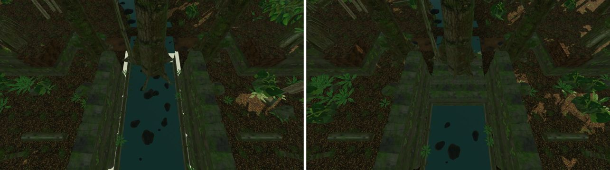
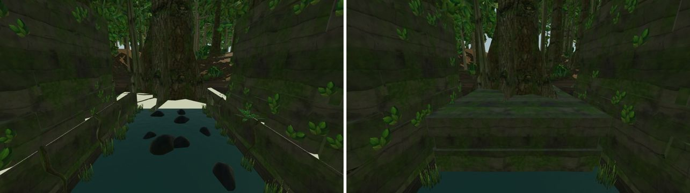
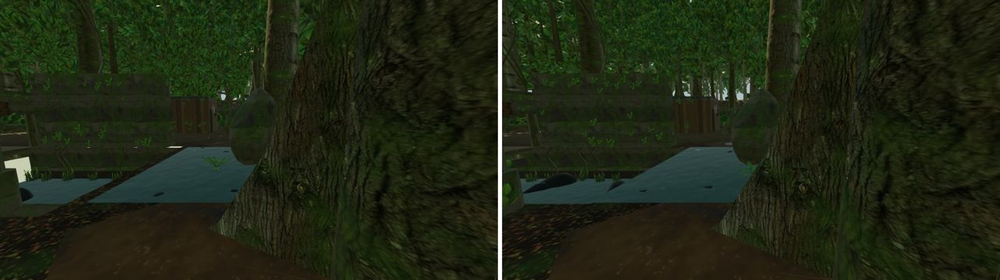
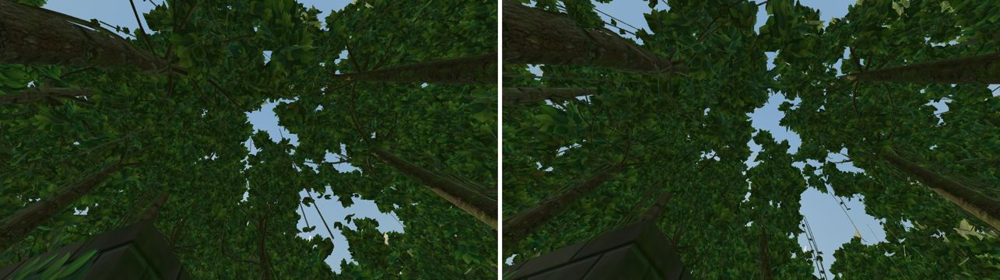

# LOST TRAIL (jungle 1v1 aim map)

Branch `fps-map-lost-trail`, on top of the shared map registry (`docs/FPS-MAP-REGISTRY.md`).
The map is in the catalog with `rotation: true` (owner's decision, 2026-11-01): new Practice and
PvP matches draw it at random with Dustfront and FROSTLINE.

## Pipeline

`art/blender/lost-trail/build.sh` runs the whole build. It is deterministic; every step is
seeded.

| Step           | File                              | Output                                                                                      |
| -------------- | --------------------------------- | ------------------------------------------------------------------------------------------- |
| Layout         | `layout.py`                       | `src/lib/fps/lost-trail-layout.ts` (gameplay solids, barriers, spawns), `build/layout.json` |
| Textures       | `textures.py`                     | `build/tex/*.png` (generated, plus CC0 bark scans and optional scanned overrides)           |
| Tree skeletons | `trees/generate_trees.mjs`        | EZ-Tree (MIT) OBJ files: five archetypes × near/far                                         |
| Scene          | `build_trail.py` (+ `scanned.py`) | `build/lost-trail.glb`, `build/lost-trail.blend`                                            |
| Instancing     | `instance_sections.mjs`           | Per-section `EXT_mesh_gpu_instancing`, shuffled instance order                              |
| Compression    | `gltf-transform meshopt`          | `public/fps/models/lost-trail.glb`                                                          |

Optional scanned CC0 assets are covered in `art/blender/lost-trail/source/SCANNED-ASSETS.md`.

## Art rules

- **Collision is the truth.** Every gameplay solid is dressed inside its collision box:
  - layered rock beds and jointed blocks are set back at most 10 cm;
  - boulders are clamped to their box;
  - the ridge top stays flush, because players stand on it.

  Nothing visual taller than ankle height stands in a lane unless it is a solid. The ford
  stones are about 7 cm tall.

- **Decoration out of head height.** On the giant trees, hanging vines and aerial roots end at
  least 5.5 m above the base in tree units (≥ 7.7 m on the in-arena giants, ≥ 4 m on the forest
  edge). Epiphytes sit at 4 m or higher. Strangler roots are only on forest-edge trees outside
  the arena.
- **Mirror fairness.** Each mirrored pair of giants uses the same species and mirrored yaw.
- **No new shader cost.** Lianas, vines, roots and epiphytes use the tree's own bark and leaf
  materials, so they add no draw calls. River rock shares the rock normal map. Reeds are one
  instanced clump. Ground wetness is a vertex colour (one varying) on the ground mesh.

## Performance

Measured with `capture.mjs` on the headless capture (SwiftShader, 960×540, 4× MSAA). Each view
renders one warm-up frame, then three measured frames ending in a 1-pixel readback (median).
Calls and triangles are the map only (no players or viewmodel). The full comparison with the
other maps is in `docs/fps-map/RENDER-AUDIT-2026-11-02.md`.

Generic views (`compare-40x32.views.json` / `compare-44x36.views.json`: both spawns, both ends,
mid-arena both ways, overhead). Ranges cover the six player-height views:

|                    | Dustfront | FROSTLINE | LOST TRAIL before fixes | LOST TRAIL now |
| ------------------ | --------- | --------- | ----------------------- | -------------- |
| Draw calls         | 43–55     | 54–67     | 143–209                 | 131–188        |
| Triangles          | 21–26 k   | 49–58 k   | 694–863 k               | 300–387 k      |
| Software frame (s) | 0.7–1.1   | 0.9–1.4   | 14.4–18.6               | 8.5–11.7       |
| GLB (meshopt)      | 0.91 MB   | 1.48 MB   | 3.46 MB                 | 2.83 MB        |

LOST TRAIL is still about ten times Dustfront's frame cost in software rendering. What it is
made of (same views, things hidden one at a time): leaf cards are about 80–90% of it (canopy
crowns about half, broad-leaf midstory a quarter to a third, ferns, bushes and palms under 5%).
The cost is overdraw of alpha-tested cards, not shading: dropping normal maps, reflections and
shadow receiving on the leaves saves about 15%.

Fix pass (2026-11-02) changes behind these numbers:

- **Leaf cards.** Every tree level drops whole cards and grows the kept ones about their own
  centres (`thin_leaves`): near and giant trees keep 50% at 1.12×, far trees 60% at 1.1×,
  background trees 60% of the far level at 1.15×. Card area drops to about 0.6–0.75 of before;
  the canopy still reads closed from below.
- **Bark.** Near crowns' twigs 30% kept (was 45%), far crowns' twigs now decimated too (32%);
  trunks below the crown keep every ring. The background level reuses the far bark (a
  whole-mesh decimate there would erase the trunk).
- **Giant-tree dressing.** Lianas and strangler roots are 4-sided tubes, fewer strangler roots,
  single-segment epiphyte cards.
- **Variants.** One palm, fern, bush and rock (yaw and scale vary them); slender trees use one
  level; no broad tree in the near band. Each variant cost a draw in every culling section.
- **Spacing.** Far band 6.6 m (was 6.0), background band 9.5 m (was 8.0).
- **Boulders.** Instanced rock and river rock are subdivision 2 (320 → 80 triangles).
- **Draw order.** Foliage draws after every solid, the near forest before the background
  (`renderOrder` in `lost-trail-environment.ts`). three sorts opaque draws by material before
  depth, so leaf cards could be drawn first and shaded in full behind walls, trunks and the
  ground. SwiftShader does not reject those fragments early, so the table above does not show
  this; GPUs with early depth testing do.

Pass 3 (before): near crown bark 45% kept, buttress fins in the trunk's material, single reed and
wet-rock libraries, welded tubes and boulders.

### Graphics quality "Low" (Settings → Graphics)

- Every background-section batch (beyond 6.5 m outside the playable edge) draws a seeded random
  half of its instances. The kept trees grow 14% so the far canopy still reads as closed.
- The forest edge and the arena are untouched, so sight lines are identical on both settings.
- The cached shadow map is re-rendered once when the setting changes.
- There is no new shader and no per-frame work.

## Gorge and river-tree (fix pass)

Before the fix the gorge showed the sky through the ground (a white strip along both rims and a
"white window" at each end) and the river-tree stood on nothing:

- The ground grid had 1 m cells and skipped every cell whose centre was in the gorge (x −3…3),
  but the gorge walls stand at x ±2.6: a 0.4 m void along both rims. The gorge ends had no end
  walls, so the drop from the crossings' water to the bed was open. Ground also sat under the
  bridge between the two gorge halves.
- The river-tree (x 0, z −10.6) stands in the north gorge. Its base and buttress fins were at
  ground height over the water, and its surface roots lay on air.

Now:

- The ground grid has lines exactly on the rims (x ±2.6), the crossing edges and the bridge
  deck's bank ends, so ground meets the gorge walls edge to edge. No ground is drawn under the
  deck's bank ends (the deck top is the ground there).
- The gorge is one cut from the north crossing to the ford, running on under the bridge. Its
  ends have rock walls that follow the ground's edge heights down past the bed.
- A layered rock outcrop fills the gorge's north end (z −12.6…−6.9, top 0.25 m). The tree's
  trunk and fins grow out of it. Gorge boulders and reeds start south of it, and any surface
  root reaching the open water stops at the lip.
- Collision is unchanged: the outcrop is inside the existing `gorge-north` barrier.

## Practice bot

The bot's path grid keeps 0.18 m beyond the player radius, so gaps players squeeze through
(about 0.9–1.0 m) are closed to it. Three small layout adjustments give it the bridge and the
north bank:

- The bridge crate stack is 0.9 m across the deck, leaving two 1.25 m lanes.
- The bridgehead rocks sit 0.3 m nearer the gorge.
- The plaza logs sit 0.4 m nearer the spawns.

Spawn safety, first contact and route times are unchanged. All nine first-round patrols
reveal the bot to an idle player within 20 s (6.6–19.1 s), the bound pinned by
`tests/fps-practice-bot-reveal.test.ts` (from the FROSTLINE branch).

## Verification

- `tests/fps-lost-trail-layout.test.ts`: layout, spawn safety, reachability, first contact,
  post view and bot patrols on the real movement and visibility code.
- `tests/fps-lost-trail-quality.test.ts`: low thins only background batches; high restores
  them exactly.
- `scripts/fps/map-capture/capture.mjs`:
  - `lost-trail <out> [views] [--quality=low]` writes screenshots and per-view draw calls,
    triangles and frame time (median of three frames after a warm-up frame; each frame ends
    in a 1-pixel readback, since `gl.finish()` does not wait under SwiftShader).
  - `--lifecycle=dustfront,lost-trail --cycles=N` mounts and disposes map environments
    repeatedly. GPU geometries and textures must not grow (map-switching / resource-cleanup
    check).
- `tests/e2e/fps-frostline-perf.spec.ts` (`MAP_PERF_MAPS=lost-trail`) does not finish within its
  15-minute limit on SwiftShader, before or after the fix pass (Dustfront takes about 5 minutes).
  Use the capture for map-to-map comparisons on software rendering.
- Still to do: real-GPU Chrome and Firefox frame timing on a player's machine.
