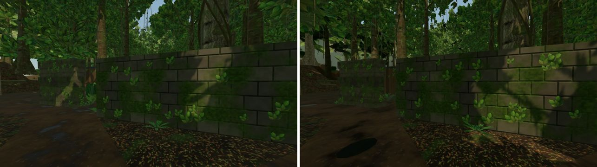
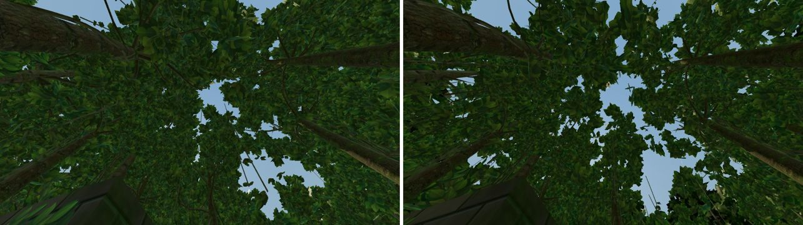
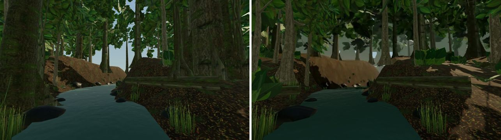

# LOST TRAIL (jungle 1v1 aim map)

Branch `fps-map-lost-trail`, on top of the shared map registry (`docs/FPS-MAP-REGISTRY.md`).
The map is in the catalog with `rotation: true` (owner's decision, 2026-11-01): new Practice and
PvP matches draw it at random with Dustfront and FROSTLINE.

## Pipeline

`art/blender/lost-trail/build.sh` runs the whole build (about 2.5 minutes). Every step is
seeded; the backdrop bake (software-rendered) can differ by a few texels between runs. The bake needs headless Chromium (`CHROMIUM=/path/to/chrome`, otherwise Playwright's).

| Step           | File                              | Output                                                                                      |
| -------------- | --------------------------------- | ------------------------------------------------------------------------------------------- |
| Layout         | `layout.py`                       | `src/lib/fps/lost-trail-layout.ts` (gameplay solids, barriers, spawns), `build/layout.json` |
| Textures       | `textures.py`                     | `build/tex/*.png` (generated, plus CC0 bark scans and optional scanned overrides)           |
| Tree skeletons | `trees/generate_trees.mjs`        | EZ-Tree (MIT) OBJ files: five archetypes × near/far                                         |
| Scene, pass 1  | `build_trail.py` (+ `scanned.py`) | `build/lost-trail-full.glb`: the whole forest, only to bake the backdrop from               |
| Backdrop bake  | `bake/bake.mjs`, `bake/entry.ts`  | `build/backdrop/`: the forest beyond the walls, rendered by the game's own loader           |
| Backdrop atlas | `bake/compose.py`                 | `build/tex/forest_backdrop.png` (2048 × 1228)                                               |
| Scene, pass 2  | `build_trail.py` (backdrop on)    | `build/lost-trail.glb`, `build/lost-trail.blend`                                            |
| Instancing     | `instance_sections.mjs`           | Per-section `EXT_mesh_gpu_instancing`, shuffled instance order                              |
| Compression    | `gltf-transform meshopt`          | `public/fps/models/lost-trail.glb`                                                          |

Optional scanned CC0 assets are covered in `art/blender/lost-trail/source/SCANNED-ASSETS.md`.

## Art rules

- **Collision is the truth.** Every gameplay solid is dressed inside its collision box:
  - layered rock beds and jointed blocks are set back at most 10 cm;
  - boulders are clamped to their box;
  - the ridge top stays flush, because players stand on it.

  Nothing visual taller than ankle height stands in a lane unless it is a solid. The ford
  stones are about 7 cm tall.

- **Decoration out of head height.** On the giant trees, hanging vines and aerial roots end at
  least 5.5 m above the base in tree units (≥ 7.7 m on the in-arena giants, ≥ 4 m on the forest
  edge). Epiphytes sit at 4 m or higher. Strangler roots are only on forest-edge trees outside
  the arena.
- **Mirror fairness.** Each mirrored pair of giants uses the same species and mirrored yaw.
- **No new shader cost.** Lianas, vines, roots and epiphytes use the tree's own bark and leaf
  materials, so they add no draw calls. River rock shares the rock normal map. Reeds are one
  instanced clump. Ground wetness is a vertex colour (one varying) on the ground mesh.

## Performance

Goal: as smooth as Dustfront. Measured with `capture.mjs` on the headless capture (SwiftShader,
960×540, 4× MSAA): one warm-up frame per view, then the median of three frames, each ending in
a 1-pixel readback. Calls and triangles are the map only (no players or viewmodel). The full
comparison with the other maps is in `docs/fps-map/RENDER-AUDIT-2026-11-02.md`.

Generic views (`compare-40x32.views.json` / `compare-44x36.views.json`: both spawns, both ends,
mid-arena both ways). Overdraw is the average number of fragments rasterised per pixel (every
mesh drawn additively without depth test, alpha ignored) in the B, mid-east and N views.

|                    | Dustfront | LOST TRAIL as built | After pass 1 | Now (pass 2) |
| ------------------ | --------- | ------------------- | ------------ | ------------ |
| Draw calls         | 43–55     | 143–209             | 131–188      | 109–161      |
| Triangles          | 21–26 k   | 694–863 k           | 300–387 k    | 200–258 k    |
| Overdraw           | 5.6–7.2   | –                   | 30–34        | 10.5–11.9    |
| Software frame (s) | 0.7–1.1   | 14.4–18.6           | 8.5–11.7     | 2.8–3.7      |

Full game (`tests/e2e/fps-frostline-perf.spec.ts`, real renderer with both players and the
viewmodel, SwiftShader; `docs/fps-map/lost-trail-perf-chromium-lost-trail.json`): the sequence
now finishes in 10 minutes (before pass 2 it did not finish within the 15-minute limit).
Median frame 12.6–12.9 s against Dustfront's 5.0–6.5 s on the same harness, 185–189 draw
calls against 84, 384 k triangles against 159 k, CPU per frame 8.3–9.0 ms against 4.2–8.0 ms.

Where the rest goes (same views): without any leaf card the map renders in 1.1–1.4 s; the
leaves' vertices cost about 0.2 s of that difference, their fragments the rest. Solids are
4.6–6.5 layers, like Dustfront's. The remaining leaf layers are the forest edge band
(2.2–3.0), the real trees between the edge and the backdrop (1.7–2.0) and the backdrop (0.6).

### Pass 2: card trimming and the forest backdrop (2026-11-02)

- **Cards trimmed to their image.** A leaf card's texture is mostly transparent (the canopy
  cluster fills 23% of its square); the transparent part is still rasterised, tested and
  discarded for every layer of foliage. Every leaf, frond and reed card is now cut to the
  rectangle holding its image's opaque texels (`alpha_bbox`, `crop_cards`, `card_quad`), so it
  covers the same leaves with 34–68% of the area. The image and the card's size on screen are
  unchanged. Overdraw 30–34 → 17–19.
- **Forest backdrop.** The forest beyond a square of walls at ±29 m (11 m past the east and
  west edges, 15 m past the north and south ones) is replaced by one picture of it. Pass 1
  builds the whole forest. `bake/` renders it through the game's own map loader, lighting, fog
  and tone mapping, from the arena centre through the four horizontal faces of a cube. A
  clipping plane keeps only what lies beyond each face's wall. Each wall is parallel to its
  face's image plane, so the picture maps onto it exactly from the centre. Pass 2 places
  the four walls and leaves out every plant whose base lies beyond ±33 m, so the crowns of trees
  just outside the walls still reach in. At runtime the walls are one draw, unlit and as baked
  (`prepareBackdrop`: alpha-tested basic material, no fog, tone mapping or shadow), with the
  solids. The game's sky dome shows above the canopy. Gaps up to 3.5° wide between trunks below
  16° elevation are filled with forest-and-haze colour. Otherwise, from anywhere nearer a wall,
  the sky behind the whole forest would show between trunks. Wide openings such as the river
  valley keep their sky.
- **Thinner near crowns.** Near and giant trees keep 30% of their leaf cards (grown 1.15×; was
  50% at 1.12×), far trees 50% (was 60%). The near band has no twisted midstory trees.

Trade-offs: close to a wall corner the backdrop is seen at an angle and reads flatter, and
looking straight up near the edge shows a little more sky than before.

Before (as built) and after pass 2:

### Pass 1 (2026-11-02)

- **Leaf cards.** Every tree level drops whole cards and grows the kept ones about their own
  centres (`thin_leaves`). The background level is 60% of the far level at 1.15×.
- **Bark.** Near crowns' twigs 30% kept (was 45%), far crowns' twigs now decimated too (32%);
  trunks below the crown keep every ring. The background level reuses the far bark (a
  whole-mesh decimate there would erase the trunk).
- **Giant-tree dressing.** Lianas and strangler roots are 4-sided tubes, fewer strangler roots,
  single-segment epiphyte cards.
- **Variants.** One palm, fern, bush and rock (yaw and scale vary them); slender trees use one
  level; no broad tree in the near band. Each variant cost a draw in every culling section.
- **Spacing.** Far band 6.6 m (was 6.0), background band 9.5 m (was 8.0).
- **Boulders.** Instanced rock and river rock are subdivision 2 (320 → 80 triangles).
- **Draw order.** Foliage draws after every solid, the near forest before the background
  (`renderOrder` in `lost-trail-environment.ts`). three sorts opaque draws by material before
  depth, so leaf cards could be drawn first and shaded in full behind walls, trunks and the
  ground. SwiftShader does not reject those fragments early, so the table above does not show
  this; GPUs with early depth testing do.

Before (art pass 3): near crown bark 45% kept, buttress fins in the trunk's material, single
reed and wet-rock libraries, welded tubes and boulders.

### One render configuration

The former Graphics setting (High / Low, where Low drew half of each background batch) was
removed on 2026-11-02 with the single render configuration (`docs/fps-map/RENDER-AUDIT-2026-11-02.md`).
The build still shuffles each batch's instance order, so a prefix of a batch is an even subset.

## Gorge and river-tree (fix pass)

Before the fix the gorge showed the sky through the ground (a white strip along both rims and a
"white window" at each end) and the river-tree stood on nothing:

- The ground grid had 1 m cells and skipped every cell whose centre was in the gorge (x −3…3),
  but the gorge walls stand at x ±2.6: a 0.4 m void along both rims. The gorge ends had no end
  walls, so the drop from the crossings' water to the bed was open. Ground also sat under the
  bridge between the two gorge halves.
- The river-tree (x 0, z −10.6) stands in the north gorge. Its base and buttress fins were at
  ground height over the water, and its surface roots lay on air.

Now:

- The ground grid has lines exactly on the rims (x ±2.6), the crossing edges and the bridge
  deck's bank ends, so ground meets the gorge walls edge to edge. No ground is drawn under the
  deck's bank ends (the deck top is the ground there).
- The gorge is one cut from the north crossing to the ford, running on under the bridge. Its
  ends have rock walls that follow the ground's edge heights down past the bed.
- A layered rock outcrop fills the gorge's north end (z −12.6…−6.9, top 0.25 m). The tree's
  trunk and fins grow out of it. Gorge boulders and reeds start south of it, and any surface
  root reaching the open water stops at the lip.
- Collision is unchanged: the outcrop is inside the existing `gorge-north` barrier.

## Practice bot

The bot's path grid keeps 0.18 m beyond the player radius, so gaps players squeeze through
(about 0.9–1.0 m) are closed to it. Three small layout adjustments give it the bridge and the
north bank:

- The bridge crate stack is 0.9 m across the deck, leaving two 1.25 m lanes.
- The bridgehead rocks sit 0.3 m nearer the gorge.
- The plaza logs sit 0.4 m nearer the spawns.

Spawn safety, first contact and route times are unchanged. All nine first-round patrols
reveal the bot to an idle player within 20 s (6.6–19.1 s), the bound pinned by
`tests/fps-practice-bot-reveal.test.ts` (from the FROSTLINE branch).

## Verification

- `tests/fps-lost-trail-layout.test.ts`: layout, spawn safety, reachability, first contact,
  post view and bot patrols on the real movement and visibility code.
- `tests/fps-lost-trail-quality.test.ts`: foliage draw order; the backdrop is drawn unlit, as
  baked, never as foliage.
- `scripts/fps/map-capture/capture.mjs`:
  - `lost-trail <out> [views]` writes screenshots and per-view draw calls,
    triangles and frame time (median of three frames after a warm-up frame; each frame ends
    in a 1-pixel readback, since `gl.finish()` does not wait under SwiftShader).
  - `--lifecycle=dustfront,lost-trail --cycles=N` mounts and disposes map environments
    repeatedly. GPU geometries and textures must not grow (map-switching / resource-cleanup
    check).
- `tests/e2e/fps-frostline-perf.spec.ts` (`MAP_PERF_MAPS=lost-trail`) takes about 10 minutes on
  SwiftShader (Dustfront about 5).
- Still to do: real-GPU Chrome and Firefox frame timing on a player's machine.
