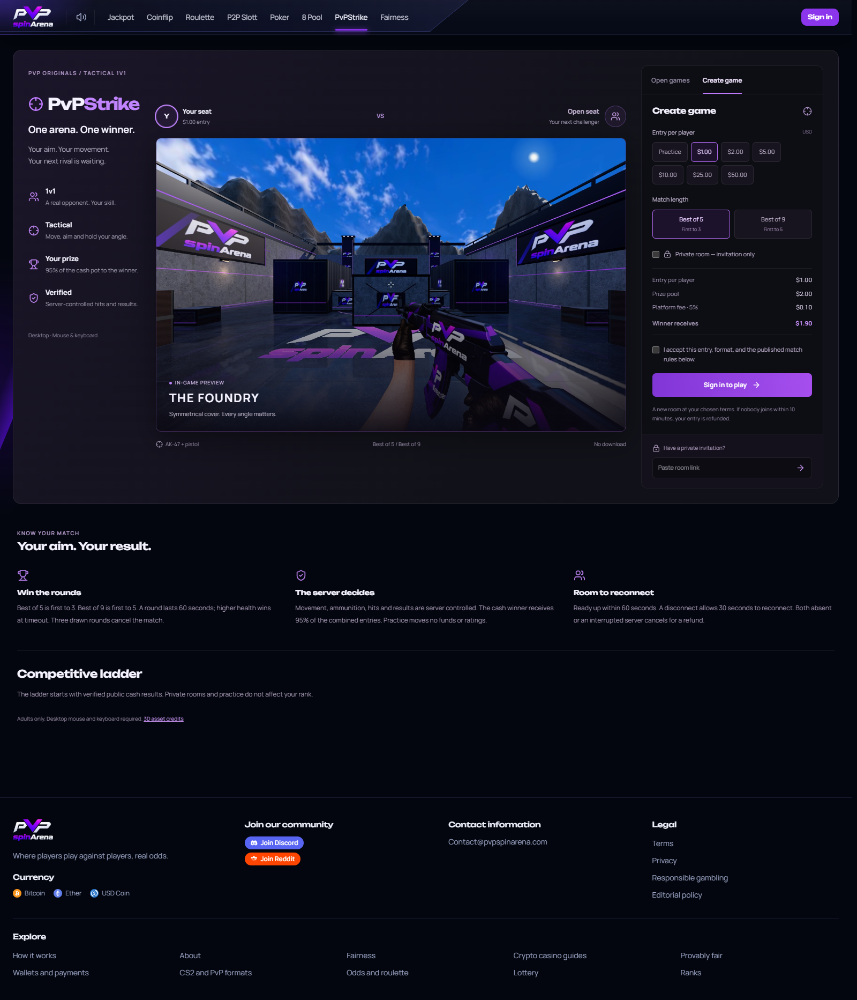

# PvPStrike lobby and cash release — 2026-10-30

PvPStrike is merged, deployed and enabled for cash entries under the user's explicit
instruction to fix the lobby, merge/deploy, then turn on cash. This supersedes the
practice-only authorization in the earlier release report. Deposit and withdrawal
settings are unchanged.

## Live result

- [PvPStrike](https://pvpspinarena.com/fps-duel)
- [PR #4](https://github.com/Ddenbror97/pvp-arena/pull/4)
- Application code: `c3d337a30cae254f4c3937c24b0a52b4fce42f91`
- Merge: `68756e514b642fb40c753a6a4816039da91f6727`
- App deployment: `98cd3df7-9bdb-426c-a90e-01f7d42ca9e2`
- Runtime unchanged: `fadedff7-98a8-418e-b253-4bab0f8e527a`
- Production migration count: 299; latest `20261030195714`.
- FPS configuration: enabled, cash enabled, practice allowed.
- Entries: free practice, $1, $2, $5, $10, $25, $50. Cash fee is 5% of the combined
  entries; a $1-per-player game pays its winner $1.90 and the platform $0.10.

## Behavior

The header and mobile navigation place PvPStrike immediately beside 8 Pool. The
lobby has an actual arena screenshot, matchup preview, open-room list and separate
creation panel. Its 235KB screenshot does not instantiate WebGL or download the
match renderer. Narrow screens stack the showcase and controls without horizontal
page overflow. Mouse and keyboard are required to create or join from this lobby.

Create always opens a new room at the accepted entry and series; it cannot silently
join an existing paid room. Join reviews that specific room's entry, series, fee
and payout before reserving funds. Private invitations, active-room recovery,
practice, live spectating, rules and the competitive ladder remain available.

The new authenticated creation RPC uses the existing ledger, live-session,
idempotency, self-exclusion, restriction, concurrency and refund checks. Its private
helper is not callable by browser or service roles. Configured cash tiers are now
enforced in the database as well as the UI. The existing queue API remains
compatible. The migration itself never changes the cash-enable flag.

## Verification

All 667 unit tests passed, including 33 FPS ledger/RPC tests. Four native Postgres
checks passed against the full migration chain. Typecheck, changed-source lint and
GitHub rollout CI run 43 passed. Browser checks passed at desktop, 390px and 320px.

Hosted Fresh staging completed a paid BO5 through the new creation and join-review
UI: movement, shooting, damage, reconnect and a 3–0 finish. Settlement paid exactly
$1.90 once, charged the $0.10 fee and reconciled both balances. Independent hosted
create/join/replay races produced distinct new rooms, exactly one join-race winner,
no duplicate debit and exact balance restoration. All 12 hosted ledger, refund,
restriction and conservation checks passed.

An initial local UI run preceded local runtime readiness. Subsequent local movement
checks timed out; the full gameplay acceptance test was therefore run on the
hosted staging app/runtime, where it passed. A simultaneous heavy browser/unit run
also timed out the inherited poker fairness check; the full 667-test run passed
with two workers. These unsuccessful runs are not counted as passes.

Production smoke completed a private zero-stake BO5, including invitation entry,
combat, reconnect and authoritative 3–0 recording, before cash activation. After
activation, the live cash UI showed the correct entry and payout; a zero-balance
QA account's cash creation request failed without creating a room or ledger entry.
No production account was funded for testing and no real-money production wager
was placed by this release test. Paid settlement was tested with synthetic staging
funds only.

Both production QA accounts are disabled again, with zero sessions, active QA
matches, nonzero balances or ledger transactions. All production money-invariant
booleans pass. Financial settings and the preflight ledger totals/counts are
unchanged. The two previously documented historical BTCPay flow diagnostics remain
unchanged; no provider records or financial repairs were invented.

Postflight preserved all 32 app secrets, all existing public variables, both root/www
routes and the minute cron. Runtime code, namespace and configuration are unchanged.
Live tails captured 61 app and 84 runtime events with zero exceptions, HTTP 5xx or
console errors. Five app and one runtime invocations were canceled during browser
navigation/socket closure; they contained no exceptions. This is a bounded smoke
observation, not an unlimited availability or anti-cheat guarantee.

## Recovery and evidence

A fresh 33,905,343-byte production snapshot was verified through isolated recovery
and this single migration. The previously approved restored-copy-only quarantine
preserved the same 39 pre-existing orphaned Auth claims. The source production
rows and original archive were not changed. Restore checks retain the earlier
logical-backup limitation: no-owner/no-privileges does not certify control-plane
or hosted-role restoration.

Rollback version `f6b59b96-0ce1-43bb-a68a-2e019a5431e2` remains available through the
provider version API. Disable new FPS cash entries before rolling the app back;
allow existing games to settle/refund through their ordinary lifecycle. The
compatible migration can remain applied; do not rewrite migration or Git history.

Fresh private logs, reports and traces remain ignored under `test-results/`; secrets,
operator files and backups remain ignored under `.env.*` and `.wrangler/`. The first
Playwright invocation reset its default ignored results directory, so some older
local traces referenced by the earlier report are no longer available. Current
release evidence was regenerated and the public production screenshot above is
retained in Git. Historical reports remain records of their original runs.

The user's earlier alert-delivery/incident-response waiver remains in force. The
previously documented competitive-security limitations remain; this lobby release
does not claim independent anti-aimbot, collusion or latency-rewind certification.
