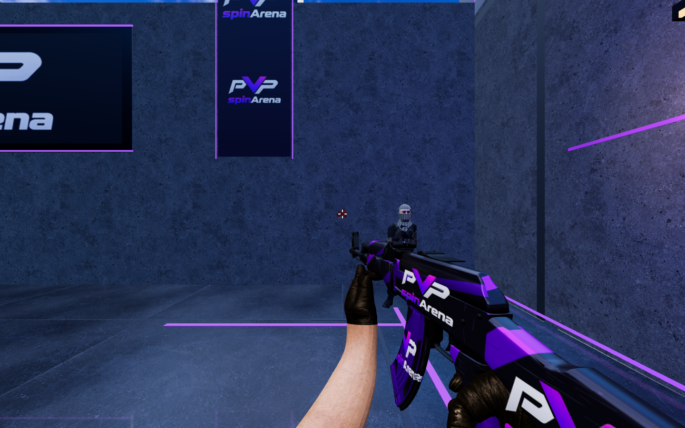

# PvPStrike combat release — 2026-10-30

Production release completed after PR [#7](https://github.com/Ddenbror97/pvp-arena/pull/7), merge `539a6f9001b851cfb70910f739c069c49bc8fbca`. Cash entry is enabled again with the original stakes and 5% fee. No schema or payment-provider changes were made.

## Gameplay

- AK-47 is full-auto at a 100 ms minimum shot interval. Players tap or release after short bursts themselves; there is no automatic burst mode.
- Rifle landed-hit damage: head 50, chest 34, stomach 30, legs 20. Two head hits kill a full-health target. Pistol damage is 50/25/22/15 for the same zones.
- The server owns recoil, spread state, hit volumes, occlusion and damage. A repeatable original 30-shot AK pattern climbs before sweeping sideways. Players can compensate with mouse movement; moving and airborne firing incur additional spread.
- Short bursts recover faster than sustained sprays. The design was informed by [Valve’s Second Shot explanation](https://blog.counter-strike.net/second-shot/). This is an original CS:GO-inspired tuning, not a reproduction of Valve’s exact spray pattern.
- Recorded gunshots and alternating stone footsteps replace the earlier synthesized cue. Seven mono samples total 196,188 bytes, decoded once after a user gesture. Pan, attenuation, obstruction filtering, mute integration and a 24-voice cap keep playback bounded. Footsteps depend on real grounded travel, not keys being held against a wall. Recording provenance and CC0 licenses are in `public/fps/audio/ATTRIBUTION.md`.
- Confirmed hits can stain nearby walls or floors. Server-owned traces select actual environment surfaces. Blood uses fixed pools of 48 marks and 96 droplets, cleared at each round, with two render objects.
- Snapshot redaction strips hidden players’ positions from audio events and hides unseen hit metadata. Old cached clients cannot create/join funded rooms with the old combat version. Legacy room checkpoints retain their previous rules.

## Validation

- Full unit suite: 76 files, 687 tests passed. Follow-up combat suite: 20 passed, including a newly added frame-step independence check. Updated runtime protocol suite: 15 passed.
- Typecheck, lint, production build and private-value/source/bundle scan passed. The production bundle targets the production Supabase project.
- Six actual keyboard/mouse bot rounds passed, final score 5–1, with audited damage, respawns and movement.
- Recorded audio decoding/playback/deduplication/mute/voice limits and pooled blood effects passed browser checks.
- A real confirmed 50-damage head hit left a visible stain on the nearby wall. The local visual fixture measured 13.9 ms median and 21 ms p95 animation frame intervals over 120 samples. This is one workstation measurement, not a guarantee for other devices.
- Five final hosted staging browser tests passed, including paid BO5 play, reconnect and exact-once ledger settlement (synthetic $2 pot, $1.90 payout, $0.10 fee).
- Production private zero-stake BO5 passed 3–0 through the real UI and runtime, including walking, firing, damage, reconnect and completion. All seven audio responses were HTTP 200; confirmed shot/step/hit events arrived. No browser page errors, QA funding, payout, fees or ledger postings.
- Four live navigation/loading/lobby browser checks passed, including lazy 3D loading, image hover warming and layout stability.
- An initial optional wall screenshot fixture did not reset camera orientation after test placement; its round reset was corrected and the test passed. The first production test attempt used the obsolete invitation field name `invite`; changing the private test lookup to the existing `token` column allowed the same waiting room to complete. Neither fix changed production game code or schema.

## Cutover and preservation

- New FPS entries closed: 2026-10-30T22:02:43.309Z. Existing active/waiting room count was zero before runtime replacement.
- Drain confirmed: 2026-10-30T22:02:45.474Z.
- Runtime deployed: `5bf6c3d8-8402-4871-88b0-fe28d277a6eb`.
- App deployed: `8797e14b-140a-498c-8a42-841aa120f9c2`.
- Private practice validation window opened: 2026-10-30T22:04:09.489Z. Cash remained disabled during that test.
- Original cash configuration restored: 2026-10-30T22:06:56.147Z.
- All 32 app secrets, both runtime secrets, app public variables, two routes and minute scheduler were preserved. Existing Durable Object namespace `292a500113ab4d828d898d6276381f55` was preserved.
- Runtime health reports configured=true and combatVersion=2. All seven live WAV files match the tested source bytes.
- Rollback pair remains available: app `2956822c-45fc-4f03-9bcf-483bcde33cbe`, runtime `fadedff7-98a8-418e-b253-4bab0f8e527a`. Gate new FPS entry and drain active rooms before replacing the runtime; use a matched app/runtime pair.
- Final database check: 2026-10-30T22:07:18.949Z. All money invariant booleans pass; financial fingerprint is unchanged. Migration count 299, latest 20261030195714, unchanged.
- Both production QA accounts are disabled, sessions revoked, with zero nonzero wallet balances, zero ledger transactions and zero active matches.
- Observed app tail: 66 events, 0 exceptions, 0 HTTP 5xx, 0 console errors. Runtime tail: 78 events, 0 exceptions, 0 HTTP 5xx, 0 console errors. Browser-disconnect canceled outcomes were present. This is a bounded smoke-test observation.

No new multi-region load certification or long-duration soak is claimed by this release. Browser audio still requires a user gesture; Ready provides that gesture. Players with an old cached page should reload if the runtime requests a client update.

## Screenshot

Local real-renderer visual fixture: confirmed nearby wall splatter after the opponent steps aside.

Ignored operator evidence is retained under `test-results/combat-*` and `.wrangler/`; it is not published because some test artifacts can contain private session or invitation context.
