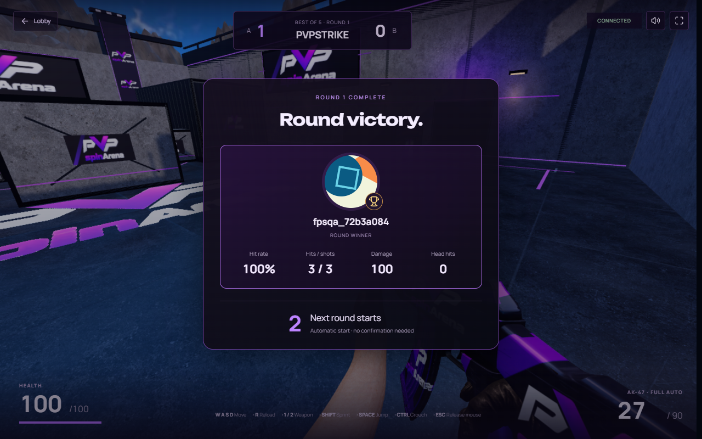

# PvPStrike entry and winner recap release — 2026-10-30

Released to production after [PR #9](https://github.com/Ddenbror97/pvp-arena/pull/9), merge 109c8753e4ea9abc1231ba01aeb80b45803acd2d. Cash entry restored at 30 October 2026 at 20:24:17 GMT-3 (America/Sao_Paulo).

## Result

Between nonterminal rounds, only the winner's profile avatar and confirmed stats appear: hit rate, hits/shots, damage and head hits. A brief purple victory burst, trophy badge and arrival animation use CSS transform/opacity; reduced-motion preferences disable the effect. A three-second server-owned break freezes actions and then resets players and starts the next round automatically. Initial match readiness keeps its three-second countdown. Draws have no fabricated winner. A zero-shot accuracy is shown as a dash, never an invented percentage.

Shots and confirmed hits are counted by the authoritative simulation; rejected cadence, empty-magazine attempts and reload attempts do not count. Damage excludes overkill. Current-round counters stay in private server state; the completed round summary is copied into the public snapshot only when the round ends. Counter reset and player reset happen once at the three-second boundary. Financial settlement and damage/recoil rules are unchanged.

Ready requests mouse capture in the original click gesture and verifies the browser event before sending Ready, including implementations returning void. Audio activation runs alongside capture. Captured players no longer get clickable confirmation buttons during round transitions. Terminal states release the cursor. Rematch terms use an explicit inline confirmation instead of window.confirm; financial entry consent remains required. Join dialogs close before navigation and their checkbox/button click targets are larger.

Creation/join intent warms model downloads. Successful authoritative action responses seed the room query, avoiding a redundant read. The creator's waiting room detects pairing every second and uses the showcase image without constructing WebGL until a rival joins. The paired room UI paints before expensive arena initialization. This addresses the measured gap between a completed room request and the apparently stalled interface.

## Verification

- 77 unit files / 697 tests passed, including server shot/hit counting, rejected-shot exclusions, frozen break actions and automatic reset at exactly 3,000 ms.
- Typecheck, lint, staging/production builds and private-value/bundle scans passed. No package or schema changes.
- Two real-renderer pointer-lock browser tests passed: a browser-style void return with capture failure rejects correctly, and a real captured mouse resolves successfully.
- Final hosted staging: five tests passed, including paid BO5 with exact-once synthetic settlement, reconnect, single-click Ready while AudioContext.resume is deliberately delayed 1.5 seconds, one winner avatar, correct profile name and server hit percentage, no transition buttons, automatic restart, released cursor at results, and inline rematch review. Four additional live production navigation/loading/lobby/CLS checks passed.
- Staging creation reached the room in 851 ms; joining reached it in 2503 ms in the final run. Earlier same-workstation investigation runs measured 4.4–6.1 seconds for creation and 2.1–5.4 seconds for joining. Network, cache and scene-initialization conditions vary, so these are observations rather than guaranteed latency bounds. Recorded action requests themselves were sub-second in the final run.
- The initial break timing assertion was made after UI/profile checks, incorrectly treating their elapsed time as a short break. It now checks the first server round-end snapshot, alongside the exact simulation deadline test.
- Production private zero-stake BO5 passed 3–0 with the same interaction and winner-recap checks. No browser page errors, native confirmation dialogs, QA funding, payout, fees or ledger transactions.

## Cutover

New FPS entry was gated; there were zero active WAITING/FUNDED rooms before runtime replacement. Runtime 5d76f703-61c3-430c-9ed0-eabdd8672af1 and app eef59d5c-82f8-4411-8293-b270294f68e1 deployed successfully. Private practice was opened for verification, QA users were disabled and their sessions revoked, then the original cash configuration was restored. Original stakes, practice setting and 5% fee are unchanged.

All 32 app secrets, both runtime secrets, public variables, routes, minute scheduler and room namespace were preserved. The previous matched rollback pair remains available: app 6f64270b-d09a-4e21-bb0b-52237fe92c0d, runtime 5bf6c3d8-8402-4871-88b0-fe28d277a6eb. Gate and drain before replacing the runtime because active room objects restart on runtime deployment.

Final financial fingerprint is unchanged, all money invariant booleans pass, and migrations remain at 299, latest 20261030195714. QA cleanup verified two disabled users, zero sessions, zero nonzero balances, zero ledger transactions and zero active QA matches. Observed tails: app 86 events, runtime 80 events; zero exceptions, HTTP 5xx and console errors. Browser-disconnect canceled outcomes were present. This bounded smoke is not a new concurrency or regional-load certification.

Players should refresh before their next match to load the new frontend. Private operator evidence remains in ignored test-results/flow-* files.
