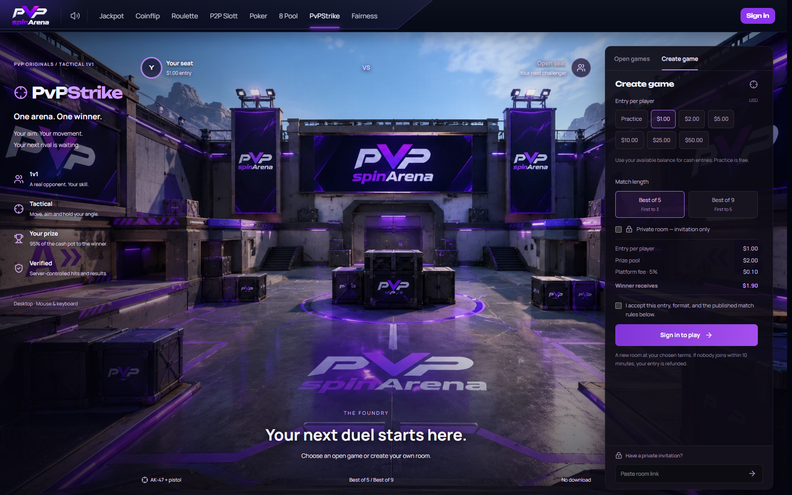

# PvPStrike full-screen showcase and loading — 2026-10-30

The supplied `ingame.png` now fills the lobby showcase, with the game controls
overlaid in the same manner as the 8-ball page. The original 2,466,044-byte image
was compressed to a 258,530-byte WebP. Production bytes match that optimized
attachment exactly. Its hashed URL has a one-year immutable cache policy.

[Live PvPStrike](https://pvpspinarena.com/fps-duel).

## Loading behavior

Document preload, hover/focus/touch warmup and the displayed image share one URL.
Header intent warms the lobby route/CSS and user-scoped React Query data. Delayed
idle warming follows the other game pages. Speculative warmup skips Save-Data/2G.
The 15.6KB lobby JavaScript chunk is separate from the 770.7KB renderer chunk
(approximately 5.2KB and 204.5KB gzipped respectively). Header hover does not
request the renderer or models. Match intent warms the renderer; mounting WebGL
and loading model assets occur inside the game.

The main stylesheet reserves the game viewport before route chunks arrive. A
loading backdrop covers unfinished models until they are ready. Fixed HUD slots
prevent score, health, ammunition and status-label movement. Model readiness gates
the Ready action, and chunk download failures show a retry message. The sidebar
reserves space while data arrives and keeps its action fully visible at 1280×800;
smaller screens retain scrollable controls.

## Verification and rollout

All 125 FPS unit tests, typecheck and changed-source lint passed. Five hosted
candidate browser tests passed: responsive lobby checks at desktop/390px/320px,
cold lobby loading, hover navigation, cold authored-model loading and paid BO5
combat/reconnect/settlement. The paid result was 3–0, with exactly one $1.90 payout
and $0.10 fee. A follow-up visual check caught and fixed a partly clipped action;
the browser regression checks its complete visible bounds.

Production passed all four final responsive/loading checks. In the final measured
run, hover navigation used one image download and displayed the lobby in 207ms.
The layout-shift sum excluding recent user input was **0.000064** for the cold
lobby and **0** for the cold arena. The canvas and game viewport were both
1280×800. These are bounded workstation/browser measurements, not CrUX field data
or promises for every device/network.

Production private practice also passed a complete 3–0 BO5 with combat, invitation
entry and reconnect. The subsequent correction changes only lobby CSS; game code
is identical. Both QA accounts are disabled again with no sessions, active QA
matches, ledger transactions or nonzero balances. No production test funding or
paid production wager was used.

[PR #5](https://github.com/Ddenbror97/pvp-arena/pull/5) merged as
`99886d36fe2b758a1a84b1d63aceb7282991c760`.
The action-visibility correction in
[PR #6](https://github.com/Ddenbror97/pvp-arena/pull/6) merged as
`3e58055a74f0a624331ba74dd527c2adfb0cd7a3`.
Final app deployment: `2956822c-45fc-4f03-9bcf-483bcde33cbe`.
No applicable GitHub Actions workflow is configured for these frontend-only paths;
checks above were run explicitly.

Cash remains enabled. No migrations, financial controls or runtime-worker changes
were made. Production retains all 32 secrets, public variables, both root/www
routes and the minute cron. Financial settings and preflight ledger totals/counts
are unchanged, and all money-invariant booleans pass. Runtime version remains
`fadedff7-98a8-418e-b253-4bab0f8e527a`.

Live monitoring captured 71 app and 84 runtime events with zero exceptions,
HTTP 5xx responses or console errors. Two app and one runtime invocations were
canceled without exceptions during browser navigation/socket closure. Rollback
version `98cd3df7-9bdb-426c-a90e-01f7d42ca9e2` remains available. Private test
reports, raw traces, operator files and credentials remain ignored; this report
and the public screenshot are retained in Git.
