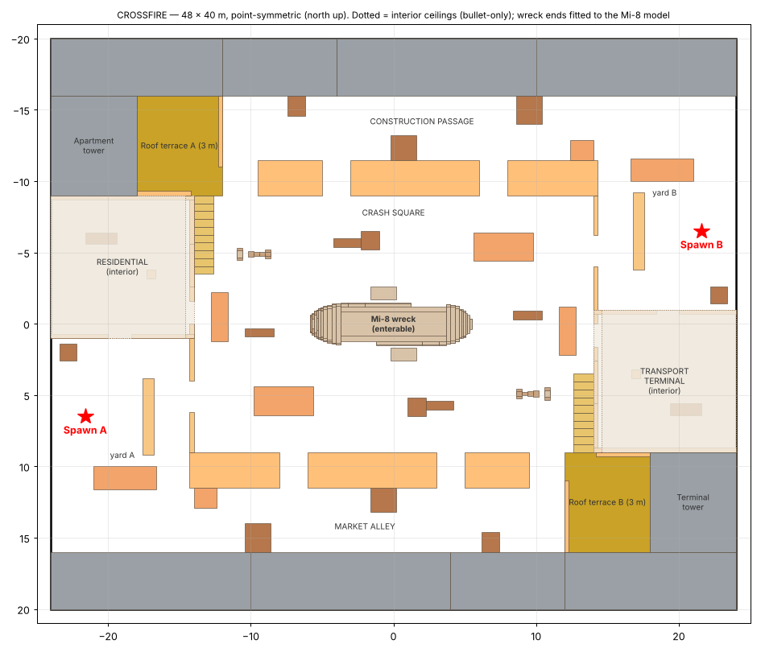
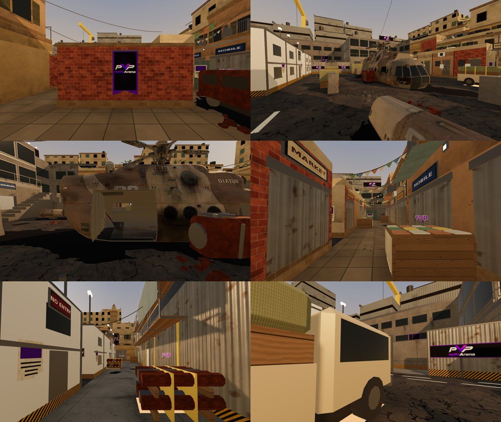
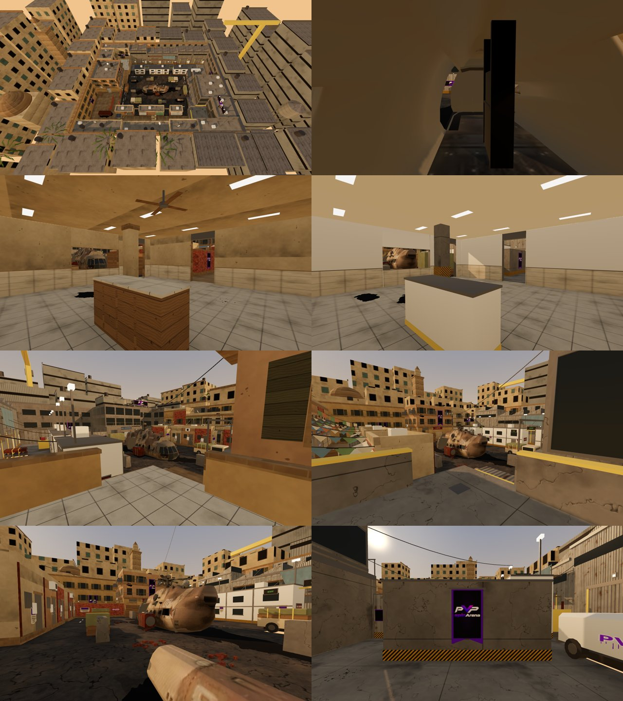

# CROSSFIRE — Urban AIM ARENA

Branch `fps-map-crossfire` (not merged, not deployed). CROSSFIRE is the fourth 1v1 map: a
war-damaged city block around a crashed Mi-8 transport helicopter, built on the shared map
pack (`docs/FPS-SHARED-MAP-PACK.md`, `docs/FPS-MAP-REGISTRY.md`). It is registered with
`rotation: true` (the owner asked for it in the rotation), so once merged and deployed every
new Practice and PvP match draws from Dustfront, FROSTLINE, LOST TRAIL and CROSSFIRE.

Shared files touched, each through a documented registry extension point:

- `maps/catalog.ts`: one import and one entry.
- `maps/loading-screens.ts`: one import and one art entry.
- `tests/fps-map-dustfront-parity.test.ts`: the `MAP_IDS` and `ROTATION_MAP_IDS` lines.
- `tests/e2e/fps-entry-loading.spec.ts`: the map-name → art table.
- `public/fps/models/ATTRIBUTION.md`: the Mi-8 credit.

The simulation, renderer, networking, match admission, characters, weapons, audio and the
other three maps are untouched. CROSSFIRE needs no environment factory (no extra effects), so it
uses the shared loader as Dustfront does.

## 1. Files

| File                                       | What it is                                                                                                       |
| ------------------------------------------ | ---------------------------------------------------------------------------------------------------------------- |
| `art/blender/crossfire/layout.py`          | Source of truth for the gameplay solids → `build/layout.json` and `src/lib/fps/crossfire-layout.ts`.             |
| `art/blender/crossfire/heli.py`            | Turns the Mi-8 model into the wreck (see §3).                                                                    |
| `art/blender/crossfire/fit_heli.py`        | Fits the wreck's curved nose, rear and boom pieces with collision boxes → `heli_fit.json` (read by `layout.py`). |
| `art/blender/crossfire/crossfire_kit.py`   | The urban environment kit, on top of the Dustfront kit (`../map/arena_kit.py`, imported, not copied).            |
| `art/blender/crossfire/textures.py`        | Procedural PBR textures: the shared Dustfront set plus brick, asphalt, terrazzo, rust, signage, decals, facades. |
| `art/blender/crossfire/build_crossfire.py` | Blender build (sections, joins, export), same as FROSTLINE's.                                                    |
| `art/blender/crossfire/build.sh`           | Pipeline: layout → textures → Blender → `check_glb.py` → GPU instancing → meshopt.                               |
| `art/blender/crossfire/crossfire.blend`    | The built scene.                                                                                                 |
| `art/blender/crossfire/source/`            | The Mi-8 source model and its licence (README there).                                                            |
| `public/fps/models/crossfire.glb`          | Shipped render asset.                                                                                            |
| `src/lib/fps/crossfire-layout.ts`          | Generated solids and spawns.                                                                                     |
| `src/lib/fps/maps/crossfire.ts`            | The `MapDefinition`: solids, spawns, bot routes, footsteps, lighting, fog, sky, shadow extent, blockout tints.   |
| `src/assets/fps/crossfire-loading.webp`    | Loading art: the owner's reference image (1672 × 941).                                                           |
| `tests/fps-crossfire-layout.test.ts`       | Competitive validation with the real movement, collision, visibility and bot code.                               |
| `tests/e2e/fps-crossfire.spec.ts`          | Browser checks: shipped GLB (z-fighting, surface/collision probes), map switching, loading art, captures.        |

Rebuild: `art/blender/crossfire/build.sh` (Blender 4 Python with `bpy`). After changing the
wreck, run `python fit_heli.py` (Blender Python) and `python3 layout.py` twice so the fit
settles, then `build.sh`.

## 2. Layout (48 × 40 m)

Spawn A west (−21.6, 6.5) in the residential spawn yard; spawn B east (21.6, −6.5) in the
transport yard. Balance is by point symmetry: every solid has a twin rotated 180° about the
origin, so both spawns get identical routes and timings while the two halves look different.
The one exception is the wreck's nose and rear (§3), fitted to the model.

- **Crash square (centre).** The Mi-8 lies on its belly along x: an enterable cabin (a door on
  each flank, window slits at crouch-to-stand height, a centre cargo bulkhead that blocks the
  door-to-door line), its broken boom in two pieces, the torn-off main gearbox, a cab-over
  pickup, supply crates and jersey barriers.
- **Market alley (A, south) / construction passage (B, north).** Behind the shop backs and
  site offices; two connectors into the square each; stalls, crates, a kiosk / pipe stacks and
  a generator.
- **Residential block (A) / transport terminal (B).** Enterable ground floors (two doors, a
  window band toward the square), a counter and a column inside.
- **Roof terraces (3 m).** Reached by stairs from the west/east street, with parapets. Each
  overlooks the opposite flank route and the near half of the square, but sees neither spawn.
- **Spawn yards.** A spawn shield, a gate toward the square and an exit into the alley.

### Validation (real movement, collision and visibility code)

`tests/fps-crossfire-layout.test.ts` runs `simulation.ts`, `collision.ts`, `visibility.ts` and
`practice-bot.ts` against `getMap("crossfire")`.

| Check                                                     | Result                                                                            |
| --------------------------------------------------------- | --------------------------------------------------------------------------------- |
| Spawn pad ↔ spawn pad line of sight (13,689 pairs)        | **0 visible**                                                                     |
| Route lengths (gate / alley / interior / terrace)         | 20.2 / 27.6 / 20.8 / 24.7 m, identical for both spawns                            |
| Walk time to route end (5 m/s)                            | 4.0 / 5.4 / 4.1 / 4.9 s                                                           |
| **First contact**                                         | **2.9–8.0 s walking**, 2.0–5.4 s sprinting, over every pairing of the four routes |
| Longest standing sightline                                | 37.5 m (a diagonal from yard A's gate); no spawn-to-spawn lane                    |
| Terrace reach                                             | sees 71% of the square, 69% of the square sees it back; sees neither spawn        |
| Terrace stairs, wreck cabin                               | climbed by walking (0.3 m risers); in through one door, out through the other     |
| Bot routes                                                | every itinerary point reachable for both spawns (2,918 grid nodes, all reachable) |
| Practice bot reveal                                       | every first-round patrol reveals itself to an idle human within 20 s              |
| Shared contract (prediction/server parity, jump fixtures) | pass with the restored original jump (0.81 m clearance)                           |
| Server redaction                                          | players either side of the wreck are hidden                                       |

## 3. Blender construction

**The wreck** (`heli.py`) uses the owner-supplied Mi-8 (credit below), adapted, not remodelled:

- landing gear, weapon pylons, rotor blades and blur discs removed; cockpit/cabin fittings that
  would stand outside the collision pruned; 3× scale (11 m fuselage), sunk 0.25 m into the
  asphalt;
- flank doors and window slits cut with exact booleans at the collision openings (the port door
  is the model's own, widened), an inner skin (dark, dusty interior) so cut edges show metal
  thickness, the missing rear clamshells closed, end bulkheads at the cabin's collision ends;
- the tail boom broken off: its front half lies in the square as two capped pieces (the
  `heli-tail` twins), the fin and tail rotor are thrown onto the terminal tower roof;
- weathered paint (sun fade, soot, dust, scratches), overlapping detail plates removed so
  nothing z-fights.

Its collision: the cabin is designed in `layout.py` (stacked flank layers that follow the
inward-leaning hull, roof, hood, bulkhead, door and slit gaps); the curved nose, rear and boom
pieces are fitted by `fit_heli.py` in 15–30 cm slabs of 2–6 height layers. Every hull vertex
and sampled surface point below 2.9 m is within 6 cm of a box (no visual-only cover).

**The environment** (`crossfire_kit.py`; 28 materials in the GLB with the wreck's, colour variants folded into tint families):

- **A side:** ochre/rose/teal plaster and brick shop rows with shopfronts (glass, shutters,
  pilasters), signs (PHARMACY, CAFE, MOBILE, BAKERY, MARKET), striped awnings, balconies,
  split AC units, laundry, bunting across the alley, satellite dishes and water tanks, a
  shell-damaged facade with soot, bullet holes and rubble; the residential interior with
  terrazzo, a tiled counter, ceiling lights and a fan.
- **B side:** concrete terminal with curtain glazing and a BUS TERMINAL sign, corrugated sheds
  with roll-up doors, portacabin site offices with floodlights, cantilevered scaffolding with
  torn sheeting, pipe stacks, a generator, construction hoarding, a white van.
- **Crash square:** asphalt with worn lane paint, bus bays and arrows, a scorch scar and gouge
  along the slide path, oil stains, cracks and debris; a burnt-out minibus in yard A.
- **Branding:** PVPSPINARENA banners behind the spawns and on the shields, a hero banner on the
  residential block, a mural over terrace A, a rooftop billboard on the terminal tower, the
  hoarding print. Never on cover faces.
- **Background:** two rings of city blocks (facade texture, 9–32 m), a dome and minaret on the
  A side, two tower cranes and a water tower on the B side, instanced palms.

Rules (as every map): dressing below 2.9 m stays within 6 cm of its gameplay box (ground detail
≤ 13 cm excepted); no coplanar overlaps (flush details 6–45 mm proud, ground decals in their
own height layers); everything above reach starts at ≥ 2.95 m.

### Asset statistics

|                                                           | Dustfront    | FROSTLINE    | CROSSFIRE                                                                                                       |
| --------------------------------------------------------- | ------------ | ------------ | --------------------------------------------------------------------------------------------------------------- |
| Shipped GLB                                               | 908 KB       | 1.48 MB      | 1.76 MB                                                                                                         |
| Triangles (map, incl. instanced)                          | 25,510       | 56,630       | 51,630 (wreck ≈ 12k)                                                                                            |
| Primitives / culling sections                             | 77 / 13      | 62 / 13      | 76 / 13                                                                                                         |
| Materials / images                                        | 27 / 26      | 23 / 35      | 28 / 42 (colour variants in tint families)                                                                      |
| Texture megapixels / est. GPU memory                      | 13.4 / 68 MB | 14.8 / 75 MB | 19.1 / 97 MB                                                                                                    |
| Coplanar overlaps (build, and browser after quantisation) | 0            | 0            | **0**                                                                                                           |
| Dressing outside its collision below 2.9 m                | 0            | 0            | **0** (kit and wreck)                                                                                           |
| Browser collision-face probes (rays at 1 m)               | all ≤ 6.5 cm | 160 / 160    | 265 probed: 196 flat boxes ≤ 6.5 cm; 69 on the wreck's curved ends, median 0.6 cm, worst 23 cm inside the curve |
| Gameplay boxes                                            | —            | —            | 191 (+4 bullet-only), 101 of them on the wreck                                                                  |

## 4. Optimization inheritance matrix

Status: **Reused** (same code/pipeline, unchanged), **Adapted** (same technique, CROSSFIRE data),
**New** (CROSSFIRE-only addition).

| Existing optimization                                                  | Where                                          | CROSSFIRE                                                                                            | Verification                         |
| ---------------------------------------------------------------------- | ---------------------------------------------- | ---------------------------------------------------------------------------------------------------- | ------------------------------------ |
| Adaptive render resolution, framebuffer cap                            | `presentation.ts` `RenderBudget`               | Reused                                                                                               | diagnostics                          |
| Separate world / weapon passes                                         | `renderer.ts`                                  | Reused                                                                                               | code                                 |
| Shader preparation before Ready                                        | `renderer.ts` `compileAsync`                   | Reused: map materials are the same `MeshStandardMaterial` family                                     | programs constant across frames (§5) |
| Static shadow map rendered once                                        | `renderer.ts`                                  | Reused; background, decals, glass, wires and lamps don't cast                                        | code                                 |
| One-time PMREM reflection capture                                      | `renderer.ts`                                  | Reused                                                                                               | capture spec                         |
| Frozen matrices for the static map                                     | `arena-environment.ts`                         | Reused                                                                                               | code                                 |
| Spatial culling sections (3 × 3 + ground/perimeter/background/details) | `build_*.py` export                            | Adapted: same node tree, section bounds widened for 48 × 40 m (x ±8, z ±7)                           | browser: 13 sections                 |
| One mesh per material per section; tiny buckets → `details`            | `arena_kit` buckets, `crossfire_kit.build`     | Reused; `details` threshold 600 triangles                                                            | 76 primitives                        |
| Colour variants as tint families (vertex colour)                       | `frost_kit.merge_tint_families`                | Adapted: plaster, brick, sandstone, concrete, wood, corrugated, canvas and paint families            | 28 materials                         |
| Linked duplicates → `EXT_mesh_gpu_instancing`                          | `build.sh` `gltf-transform instance`           | Reused (palms)                                                                                       | browser: 2 InstancedMesh             |
| meshopt + quantisation                                                 | `build.sh`                                     | Reused                                                                                               | 4.6 MB → 1.76 MB                     |
| Half-resolution low-frequency maps                                     | `textures.py` `HALF`                           | Reused and extended (normal maps of brick/asphalt/tiles/paving/sandstone, far facades)               | 19.1 MP                              |
| Shared asset ownership, synchronous release                            | `authored-assets.ts`                           | Reused via the shared loader                                                                         | map-switching spec                   |
| Instant blockout fallback                                              | `arena-environment.ts`                         | Adapted: CROSSFIRE tints in `maps/crossfire.ts`                                                      | registry                             |
| Hidden-face removal, non-overlapping trims, coplanar checks            | `arena_kit`, `check_glb.py`, browser scan      | Reused; plus `free_spans` band clipping, unique decal layers, and coplanar-face removal on the model | 0 overlaps (build + browser)         |
| Visual = collision envelope (6 cm, below 2.9 m)                        | `arena_kit.validate`, browser probes           | Reused; wreck checked by `heli.validate` with the same rule, curved ends fitted by `fit_heli.py`     | 0 violations                         |
| Baked vertex AO                                                        | `arena_kit.emit_bucket`                        | Reused (interiors darker; decals, signs and glass unshaded)                                          | —                                    |
| No real-time map lights                                                | emissive lamps                                 | Reused: emissive wall lamps, ceiling panels, billboard spots                                         | 0 lights added                       |
| Bounded effect pools, opponent rig culling, allocation-free loop       | `impacts.ts`, `renderer.ts`, `presentation.ts` | Reused unchanged                                                                                     | —                                    |
| AABB collision shared by client and server                             | registry `compileMap`                          | Adapted: CROSSFIRE solids                                                                            | unit tests                           |
| Visibility bounds prefilter, practice-bot ground grid                  | `visibility.ts`, `practice-bot.ts`             | Reused (per-map grid); CROSSFIRE routes                                                              | reachability + reveal tests          |
| Footstep surfaces as map data                                          | `footsteps` metadata                           | Adapted: concrete floor; boxes keep metal/wood                                                       | shared contract test                 |

Not applicable: none. CROSSFIRE adds no ambient effect, so it has no environment factory.

## 5. Performance (same harness, through the registry)

`tests/e2e/fps-frostline-perf.spec.ts` (the shared map-performance sequence) mounts the real
renderer with `{ mapId }`, feeds it snapshots from the real simulation and runs idle, run with
continuous turning and a full 360° look, then four mount/dispose cycles. Dustfront and
CROSSFIRE ran in the same session and browser: Chromium with SwiftShader (software rendering),
1280 × 720, so frame times are meaningless and only engine counts and CPU time compare. Raw
results: `crossfire-perf-chromium-dustfront.json`, `crossfire-perf-chromium-crossfire.json`.

| Renderer diagnostics (max over idle, run + turn, 360° look) | Dustfront         | CROSSFIRE         |
| ----------------------------------------------------------- | ----------------- | ----------------- |
| Draw calls                                                  | 84                | 91 (+8%)          |
| Triangles drawn (players, weapon and map)                   | 159k              | 185k (+16%)       |
| Shader programs                                             | 66                | 72                |
| Textures / geometries resident                              | 63 / 124          | 80 / 131          |
| Renderer CPU per frame, p50 / p95 (run + turn)              | 5.5 / 16.6 ms     | 6.3 / 11.1 ms     |
| Renderer CPU per frame, p50 / p95 (360° look)               | 4.0 / 10.4 ms     | 4.5 / 10.5 ms     |
| Ready (models loaded, shaders compiled)                     | 28.0 s            | 17.6 s            |
| 4 × mount/dispose: geometries / textures after each cycle   | 60 / 32, constant | 67 / 48, constant |
| 4 × mount/dispose: heap                                     | 110 → 130 MB      | 115 → 116 MB      |

Counts are flat across the phases, so nothing is allocated per frame, and resources are
constant over remounts, so CROSSFIRE adds no leak. The first build had 124 draw calls; folding
colour variants into tint families (one material per family, colour in the vertex colours, as
FROSTLINE does) and a larger `details` threshold brought it to 91 (primitives 113 → 76,
materials 51 → 28). **Real-GPU Chrome and Firefox frame times are not measured** (§6).

## 6. Integration status

**Done on this branch**

- Registered: `getMap("crossfire")` resolves on the client and in the match Worker, and it is
  in the rotation.
- Loading screen: CROSSFIRE's art and name through the shared loading screen; its art is warmed
  with the other rotation maps'.
- Map switching Dustfront ↔ CROSSFIRE in one page leaves no residue (browser spec).
- Verification: unit suite (`vitest --project unit`) 1,137 pass / 1 skipped; `tsc`, ESLint and
  Prettier clean on changed files; `fps-crossfire.spec.ts` 4 / 4 (GLB scan and probes, map
  switching, loading art, captures).
- Match Worker build (`wrangler deploy --dry-run`): pass, 233 KiB, includes CROSSFIRE's solids
  and no images.

**Before merging / deploying (needs the owner's authorization)**

- Merge `main` into the branch, re-run the unit suite and the browser specs.
- Deploy the match Worker only together with (or after) an app that knows CROSSFIRE: the
  server draws the map, so an old client would be sent a map it cannot load.
- Real-GPU Chrome/Firefox frame times are not measured (skipped by the owner). The procedure
  is in `docs/fps-map/FROSTLINE.md` §6 with `MAP_PERF_MAPS=dustfront,crossfire`.

## 7. Credits, limitations and risks

- **Mi-8 model:** This work is based on "helicopter mi-8"
  (https://sketchfab.com/3d-models/helicopter-mi-8-aaa58674609e40feafe816909de65ff9) by mamont
  nikita (https://sketchfab.com/mamontnikita62), licensed under CC-BY-4.0
  (http://creativecommons.org/licenses/by/4.0/). The credit is in
  `public/fps/models/ATTRIBUTION.md`, linked from the lobby. **Provenance risk:** the file's
  internal names match Call of Duty asset naming, so the uploader's right to license it is
  uncertain; the owner chose to use it. To swap it, replace `art/blender/crossfire/source/mi8`
  and rebuild (re-run `fit_heli.py`).
- The wreck's nose and rear boxes are not exact twins (the model isn't symmetric end to end):
  the nose reaches 0.4 m further. The layout test bounds the difference (volume within 30%,
  reach within 0.5 m).
- Box collision on a rounded hull: at the nose, rear and boom pieces the collision can sit up to
  23 cm outside the curved surface at face centres (never inside it by more than 6 cm). The
  browser spec allows 25 cm for those boxes only; all flat boxes keep the 6.5 cm rule.
- The cabin is dark inside by design (shade under the hull); players inside still read against
  the doors and slits.
- Texture memory is ~29 MB above Dustfront (≈ 97 MB estimated); draw calls in play are 8% above
  Dustfront's (§5).
- No smoke plume over the wreck (the reference image has one): it would be an environment
  factory effect and was left out to keep the frame budget equal to the other maps.
