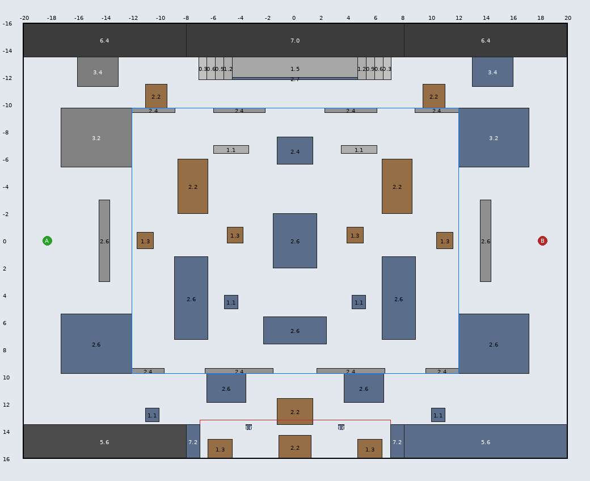
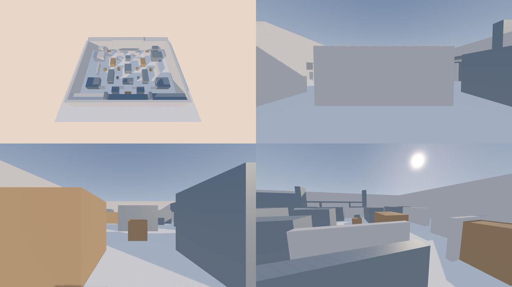
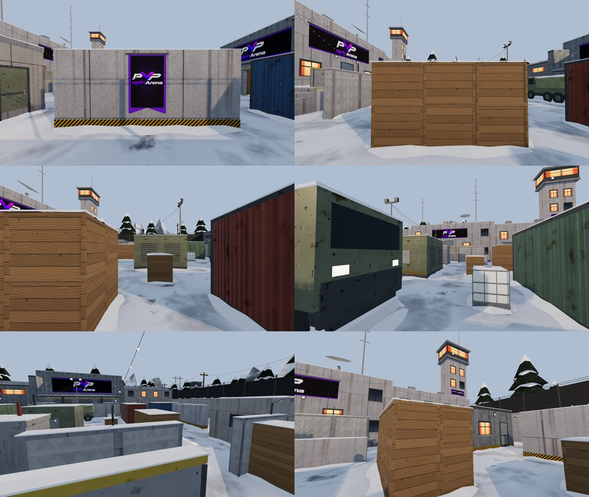
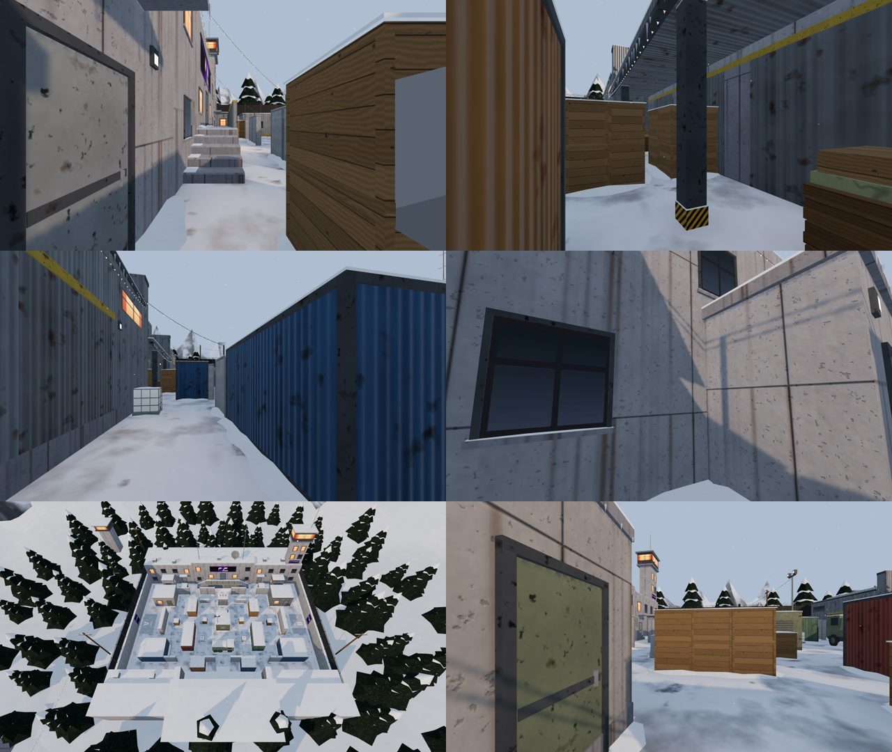

# FROSTLINE — Winter AIM ARENA

Branch `fps-frostline`, based on `fps-map-registry` at 87cadb1 (random map rotation and
per-map loading screens). Pushed for review; **not merged and not deployed**. FROSTLINE is a
second 1v1 map, registered through the shared map registry (`docs/FPS-MAP-REGISTRY.md`).

Shared files touched, each through a documented registry extension point:

- `maps/catalog.ts`: one import and one entry.
- `maps/environments.ts`: the `frostline` factory, which adds snowfall.
- `maps/loading-screens.ts`: one import and one art entry.
- `tests/fps-map-dustfront-parity.test.ts`: the `MAP_IDS` line.

Dustfront, the renderer, simulation, networking, match admission, rotation logic, weapons,
characters, impact surfaces and the LOST TRAIL work are untouched.

## 1. Files

| File                                    | What it is                                                                                                                                                            |
| --------------------------------------- | --------------------------------------------------------------------------------------------------------------------------------------------------------------------- |
| `art/blender/frostline/`                | Layout source, textures, Blender kit and build (README there).                                                                                                        |
| `public/fps/models/frostline.glb`       | Shipped render asset (meshopt + quantisation + GPU instancing).                                                                                                       |
| `src/lib/fps/frostline-layout.ts`       | Generated gameplay solids and spawns (same `Solid` format as the AIM ARENA).                                                                                          |
| `src/lib/fps/maps/frostline.ts`         | The `MapDefinition`: id `frostline`, solids and spawns from the layout file, bot routes, lighting, fog, sky, shadow extent, view distance, blockout tints, model URL. |
| `src/lib/fps/maps/catalog.ts`           | One import and one entry.                                                                                                                                             |
| `src/lib/fps/maps/loading-screens.ts`   | One entry: `frostline` → `frostline-loading.webp` (the registry's per-map loading art).                                                                               |
| `src/lib/fps/maps/environments.ts`      | `frostline` factory: the shared loader plus snowfall, disposed with it.                                                                                               |
| `src/lib/fps/snowfall.ts`               | Bounded GPU snowfall (self-contained; no renderer hook).                                                                                                              |
| `tests/fps-frostline-layout.test.ts`    | Competitive validation with the real movement/collision/visibility code.                                                                                              |
| `tests/e2e/fps-frostline.spec.ts`       | Browser checks of the shipped GLB, the environment factory and snowfall, and visual captures.                                                                         |
| `tests/e2e/fps-frostline-perf.spec.ts`  | Same-harness performance sequence for Dustfront and FROSTLINE through the registry.                                                                                   |
| `src/assets/fps/frostline-loading.webp` | Supplied loading-screen art (1672 × 941 WebP, 486 KB), shown by the shared loading screen for FROSTLINE matches.                                                      |
| `tests/fps-frostline-loading.test.tsx`  | Loading-art selection, fallback, rotation status and the rendered loading screen.                                                                                     |

## 2. Layout (40 × 32 m, courtyard 24 × 19.5 m)

Spawn A west (−18.2, 0), spawn B east (18.2, 0). Every gameplay solid is mirrored across x = 0;
only the dressing differs (west: Soviet barracks and guard post; east: watchtower and industrial
cabin).

- **Route A — central courtyard.** Diesel generator (centre), a north crate stack and a south
  shipping container per side (they block the spawn-exit bands), a transformer and an army
  truck on the centre line, low crates, jersey barriers and IBC totes.
- **Route B — upper communications.** North alley, an S-bend (barracks annex, crate stack), the
  corridor in front of the comms building, whose 1.5 m concrete walkway with a steel railing is
  the **only elevated position**; stairs at both ends, counter-angles from the courtyard through
  and over the PO-2 fence.
- **Route C — lower industrial.** South alley, container S-bends along the warehouse, the
  roofed loading bay (a covered passage under a bullet-only canopy) and two gates back into the
  courtyard.

### Validation (real movement, collision and visibility code)

`tests/fps-frostline-layout.test.ts` runs `simulation.ts`, `collision.ts`, `visibility.ts` and
`practice-bot.ts` against `getMap("frostline")`, passed explicitly or through the match's
`mapId`, exactly as a FROSTLINE match runs them.

| Check                                                                                     | Result                                                                                                                                                          |
| ----------------------------------------------------------------------------------------- | --------------------------------------------------------------------------------------------------------------------------------------------------------------- |
| Spawn pad ↔ spawn pad line of sight (3.2 × 5.6 m pads, 14,400 pairs, head/eye/chest rays) | **0 visible**                                                                                                                                                   |
| Route lengths from each spawn (main / main-south / upper / lower / walkway)               | 19.4 / 20.4 / 30.8 / 29.4 / 29.2 m, identical for both spawns                                                                                                   |
| Walk time to route end (5 m/s)                                                            | 3.9 / 4.0 / 6.1 / 5.8 / 5.8 s                                                                                                                                   |
| **First contact, main vs main**                                                           | **3.57 s walking**, 2.4 s sprinting                                                                                                                             |
| First contact, other pairings (walking)                                                   | main-south 3.87 s, upper 3.63 s, lower 4.67 s, lower vs main-south 3.53 s, main vs upper 5.0 s                                                                  |
| Longest standing sightline                                                                | 35 m, a diagonal through the courtyard (AIM ARENA: 36.5 m); no spawn-to-spawn lane                                                                              |
| Walkway coverage of the courtyard floor                                                   | 50% from the walkway centre; 45% of courtyard cells see it back (strong, not dominant)                                                                          |
| Stairs and walkway                                                                        | Climbed by walking (0.3 m risers), crossed, and left by the far stairs; the railing (2.65 m) hides a crouched player                                            |
| Openings                                                                                  | Every gate, alley, exit and the loading bay ≥ 1.2 m for a 0.7 m player                                                                                          |
| Bot routes                                                                                | Every itinerary point (all three openings, both sides) reachable from spawn B on the bot's own 0.5 m grid over the movement solids (2,058 nodes, all reachable) |
| Practice bot                                                                              | Finishes first-to-seven series on FROSTLINE (two seeds)                                                                                                         |
| Impact surfaces                                                                           | Every solid is `concrete`, `metal` or `wood` (snow reads as concrete; no engine change)                                                                         |
| Server redaction                                                                          | Players either side of the generator are hidden by FROSTLINE's walls                                                                                            |

During development the layout was revised three times from these measurements: exit-to-exit
lanes along z ≈ ±4.6 (0.5 s contact) were closed by the lane blockers; alley-to-alley lines at
z ≈ ±9.2 by extending the guard hut and fuel store to the fence line; and the upper corridor
got an S-bend.

## 3. Blender construction

The detailed map is built by `frost_kit.py` on top of the AIM ARENA's `arena_kit.py`
(imported, not copied): same geometry buckets (one mesh per culling section × material),
world-space box UVs, neighbour-aware trims, linked duplicates → GPU instancing, baked vertex AO
and the collision-envelope validation. Additions:

- **Snow and ice as geometry:** pillowy caps on every top (no bottom face, 3 cm overhang),
  sloped drifts at wall bases (≤ 16 cm, ground snow only), snow on sills, rails and the truck
  tarp, icicles kept above 2.9 m inside the arena; icy spawn pads and walkway deck (glossy, not
  mirror; no movement change).
- **Materials (23, PBR, 1K hero / 512 px low-frequency):** trodden snow with slush, ice and
  exposed asphalt; fresh snow with sparkle roughness; Soviet panel concrete with rust streaks;
  PO-2 rhombus fence relief; chipped painted steel (olive, blue, grey, red, yellow); corrugated
  containers; crate wood; tarp; lit/dark window atlas; pine; mountain rock/snow.
- **Architecture:** barracks with door canopy, comms building (walkway door, electrical boxes,
  antennas, dish, aviation lights), watchtower with lit cabin and banner, guardhouse, industrial
  shed, warehouse with a corrugated loading-bay canopy on square steel columns, roll-up doors.
- **Festive:** emissive light strings along cornices, the railing, the canopy and across the
  corridors (warm white with muted amber/red/green), lit windows, a decorated tree outside the
  north-west corner. No real-time lights.
- **Branding:** the official PVPSPINARENA logo (from `public/brand`) on the comms building, the
  warehouse front, the watchtower, spawn walls and spawn shields — never on cover faces.
- **Background:** rolling snow terrain to 140 m, seven ridge bands (100–160 m), 96 instanced
  pines, utility poles, distant watchtowers, a radar dome and a hangar. Non-colliding, no
  shadow casting.

### Asset statistics

|                                                           | AIM ARENA    | FROSTLINE                                                    |
| --------------------------------------------------------- | ------------ | ------------------------------------------------------------ |
| Shipped GLB                                               | 908 KB       | 1.48 MB                                                      |
| Triangles (map, incl. instanced background)               | 25,510       | 56,630 (pines 14.4k)                                         |
| Primitives ≈ draw calls before culling                    | 77           | 62 + 3 instanced (96 pines)                                  |
| Culling sections                                          | 13           | 13 (+3 instanced pine meshes)                                |
| Materials / images                                        | 27 / 26      | 23 / 35 (colour variants merged into vertex-tinted families) |
| Estimated texture GPU memory                              | 68 MB        | 75 MB                                                        |
| Coplanar overlaps (build, and browser after quantisation) | 0            | **0**                                                        |
| Dressing outside its collision box below 2.9 m            | 0            | **0** (ground snow excepted)                                 |
| Collision-face probes in the browser (rays at 1 m)        | all ≤ 6.5 cm | 160 / 160 ≤ 6.5 cm                                           |
| Programs for the map alone (capture renderer)             | —            | 32                                                           |

## 4. Optimization inheritance matrix

Status: **Reused** (same code/pipeline, unchanged), **Adapted** (same technique, FROSTLINE data),
**New** (FROSTLINE-only addition).

| Existing optimization                                                  | Where (verified in code)                                       | FROSTLINE                                                                                                                                                                       | Verification                                 |
| ---------------------------------------------------------------------- | -------------------------------------------------------------- | ------------------------------------------------------------------------------------------------------------------------------------------------------------------------------- | -------------------------------------------- |
| Adaptive render resolution (18.5 ms windows, scale 0.6–1.0)            | `presentation.ts` `RenderBudget`, `renderer.ts` resize         | Reused (engine unchanged). Snowfall halves its own draw range after 2 s of > 20 ms frames                                                                                       | `pixelRatio` in diagnostics                  |
| Framebuffer cap (≤ 1.5 MP, DPR ≤ 1.25)                                 | `RenderBudget.ratio`                                           | Reused                                                                                                                                                                          | diagnostics                                  |
| Separate world / weapon passes                                         | `renderer.ts` `viewScene`, layer 1                             | Reused; snowfall is on the world layer only, never in the weapon pass                                                                                                           | code, calls                                  |
| Shader preparation before Ready (`compileAsync`, hidden effects)       | `renderer.ts`                                                  | Reused; map materials are the same `MeshStandardMaterial` family (+ emissive map, + lightmap UV set) and snowfall is in the scene at compile                                    | programs stable across frames (§5)           |
| Static shadow map (rendered once after the GLB)                        | `renderer.ts` `shadowMap.autoUpdate = false`                   | Reused; background, foliage, bulbs and windows don't cast                                                                                                                       | code, frame profile                          |
| One-time PMREM reflection capture (players excluded)                   | `renderer.ts` `captureReflections`                             | Reused; snowfall draws nothing for square 90° cube cameras                                                                                                                      | browser spec                                 |
| Frozen matrices for the static map                                     | `arena-environment.ts`, `renderer.ts`                          | Reused                                                                                                                                                                          | code                                         |
| Spatial culling sections (3 × 3 + ground/perimeter/background/details) | `build_arena.py` export                                        | Reused (same grid, same node tree)                                                                                                                                              | browser: 13 sections                         |
| One mesh per material per section; tiny buckets → `details`            | `build_arena.py`, `arena_kit.build`                            | Reused                                                                                                                                                                          | 78 primitives                                |
| Linked duplicates → `EXT_mesh_gpu_instancing`                          | `build.sh` `gltf-transform instance`                           | Reused: 96 pines = 3 draws                                                                                                                                                      | browser: 3 InstancedMesh, 288 instances      |
| meshopt + quantisation                                                 | `build.sh`                                                     | Reused                                                                                                                                                                          | 4.3 MB → 1.55 MB                             |
| WebP textures, 512 px for low-frequency maps                           | `textures.py` `HALF`                                           | Reused and extended (more maps halved, no normal maps on far-only materials)                                                                                                    | 75 MB estimate                               |
| Shared asset ownership, synchronous release                            | `authored-assets.ts` `retainAuthoredAsset`                     | Reused via the shared loader                                                                                                                                                    | lifecycle cycles (§5)                        |
| Instant blockout fallback                                              | `arena-environment.ts`                                         | Adapted: FROSTLINE tints in `maps/frostline.ts`                                                                                                                                 | registry                                     |
| Hidden-face removal, trims that never overlap, coplanar checks         | `arena_kit.py`, `check_glb.py`, surface-depth spec             | Reused, plus snow rules                                                                                                                                                         | 0 overlaps (build + browser)                 |
| Visual = collision envelope (6 cm, below 2.9 m)                        | `arena_kit.validate`, surface-depth probes                     | Reused (+ ground-snow exception)                                                                                                                                                | 0 violations, 160/160 probes                 |
| Baked vertex AO                                                        | `arena_kit.emit_bucket`                                        | Reused (lighter on snow)                                                                                                                                                        | —                                            |
| No real-time map lights                                                | `arena_kit` lamps are emissive                                 | Adapted: emissive bulbs/windows + baked ground light map                                                                                                                        | 0 lights added                               |
| Bounded effect pools, no idle uploads                                  | `impacts.ts`, `blood-effects.ts`, `shell-casings.ts`           | Reused unchanged                                                                                                                                                                | —                                            |
| Bounded ambient particles                                              | **New**: `snowfall.ts` via the `frostline` environment factory | 1,800 points allocated once, animated in the vertex shader (uniforms set in `onBeforeRender`, no `update` hook), 1–3.5 px, no depth writes or shadows, faded < 1.5 m and > 16 m | browser spec: pool, layers, capture, dispose |
| Opponent rig culling, pose-slot reuse, allocation-free frame loop      | `renderer.ts`, `presentation.ts`                               | Reused unchanged                                                                                                                                                                | —                                            |
| Simplified AABB collision shared by client and server                  | registry `compileMap`                                          | Adapted: FROSTLINE solids, same `Solid` format                                                                                                                                  | unit tests                                   |
| Visibility bounds prefilter                                            | `visibility.ts`                                                | Reused (registry bounds per map)                                                                                                                                                | unit tests                                   |
| Practice-bot static ground grid                                        | `practice-bot.ts`                                              | Reused: one lazily built grid per map; FROSTLINE routes                                                                                                                         | reachability + series tests                  |
| Opponent interpolation, movement continuity, reveal gate               | `network.ts`, `presentation.ts`, `visibility.ts`               | Not map-specific: reused unchanged                                                                                                                                              | —                                            |
| Halftime side swap, combat balance                                     | `sides.ts`, `combat.ts`                                        | Not map-specific                                                                                                                                                                | —                                            |

Not applicable: none of the discovered optimizations is AIM ARENA-specific in a way that
FROSTLINE cannot use.

## 5. Performance (same harness, through the registry)

`tests/e2e/fps-frostline-perf.spec.ts` mounts the real renderer with `{ mapId }` and feeds it
snapshots from the real simulation, then runs the `fps-map-baseline` sequence. Both maps ran
in the same harness, in the same browser and in the same session: Chromium with SwiftShader
(software rendering), 1280 × 720, so frame times are meaningless and only engine counts and
CPU time compare.

| Renderer diagnostics (max over idle, run + turn, 360° look) | Dustfront         | FROSTLINE         |
| ----------------------------------------------------------- | ----------------- | ----------------- |
| Draw calls                                                  | 91                | 103 (+13%)        |
| Triangles drawn (players, weapon and map)                   | 209k              | 240k              |
| Shader programs                                             | 70                | 76                |
| Textures / geometries resident                              | 73 / 130          | 83 / 141          |
| Renderer CPU per frame, p50 / p95 (run + turn)              | 7.5 / 20.0 ms     | 5.2 / 22.6 ms     |
| Ready (models loaded, shaders compiled)                     | 33.8 s            | 34.4 s            |
| 4 × mount/dispose: geometries / textures after each cycle   | 60 / 32, constant | 71 / 41, constant |
| 4 × mount/dispose: heap                                     | 109 → 121 MB      | 113 → 118 MB      |

Counts are flat across the run, the turn and the full 360° look, so nothing is allocated per
frame. Snowfall adds one draw call. Resources are constant over remounts on both maps, so
FROSTLINE adds no leak. The 7-texture residual after dispose exists on `main` too.
**Real-GPU Chrome and Firefox frame times are still to be measured on hardware.** This
container has no GPU and no Firefox.

## 6. Integration status and instructions

**Done on this branch**

- Registered: `getMap("frostline")` resolves on the client and in the match Worker. An
  explicit `map_id: "frostline"` creates a FROSTLINE match.
- Loading screen: the shared `ArenaLoadingScreen` shows FROSTLINE's art and name, with the
  same structure, progress bar and size as Dustfront. Maps without their own art fall back to
  Dustfront's (`loadingImageFor`).
- Snowfall: built and disposed by the environment factory. The browser spec checks the
  geometry and material `dispose` events and that no scene objects are left over.
- Map switching: Dustfront → FROSTLINE → Dustfront → FROSTLINE → Dustfront in one page.
  - Every mount of a map has identical resource counts.
  - Dustfront after FROSTLINE equals Dustfront before.
  - No canvas is left behind.
  - Each GLB is fetched again on every mount, so the shared asset cache released it.

**Verification on this branch (87cadb1 + FROSTLINE)**

| Check                                                                       | Result                                                                                                                                                                                                                                                    |
| --------------------------------------------------------------------------- | --------------------------------------------------------------------------------------------------------------------------------------------------------------------------------------------------------------------------------------------------------- |
| Unit suite (`vitest --project unit`)                                        | 1,075 / 1,076 pass. The one failure is the `fps-runtime` solo-bot test: it failed 1 of 2 runs on untouched 87cadb1 and 1 of 3 here (known flake, `docs/FPS-MAP-REGISTRY.md`).                                                                             |
| FROSTLINE layout, loading, registry, runtime, parity                        | all pass                                                                                                                                                                                                                                                  |
| Type-check (`tsc --noEmit`)                                                 | pass                                                                                                                                                                                                                                                      |
| ESLint + Prettier on every changed or new file                              | clean                                                                                                                                                                                                                                                     |
| App build (`vite build`)                                                    | pass; `frostline-loading-*.webp` is emitted as a hashed asset                                                                                                                                                                                             |
| Match Worker (`wrangler deploy --dry-run`)                                  | pass, 193 KiB; includes `frostline`, bundles no images                                                                                                                                                                                                    |
| `fps-frostline.spec.ts` (GLB, snowfall, map switching)                      | 3 / 3 pass (captures skipped by default)                                                                                                                                                                                                                  |
| Dustfront browser specs `fps-surface-depth`, `fps-lifecycle`, `fps-culling` | Fail **identically on untouched 87cadb1**. The surface-depth spec looks for the scene named `aim-arena`, but the registry names it `dustfront`. The 7-texture lifecycle residual exists on `main`. Not caused by FROSTLINE; left to the registry session. |

**To put FROSTLINE into Practice/PvP**

1. Measure both maps on real hardware with `tests/e2e/fps-frostline-perf.spec.ts`: Chrome and
   Firefox, an integrated GPU, `MAP_PERF_DIR=out`. Accept if FROSTLINE's p95 frame time stays
   within the render budget that Dustfront meets on the same machine.
2. Set `rotation: true` in `src/lib/fps/maps/frostline.ts`. The registry session's rotation
   then draws it for new Practice and PvP matches, and its art joins the intent preload.
3. Update the parity test's `ROTATION_MAP_IDS` line to `["dustfront", "frostline"]`.
4. Deploy the match Worker before or with the app (`docs/FPS-MAP-REGISTRY.md`, Deploying).

**Not done (by decision)**

- Random map selection, match admission, matchmaking and the database belong to the
  registry session. They were not touched here.
- Snow and ice impact surfaces: FROSTLINE uses `concrete | metal | wood`. A snow or ice
  surface would be an engine change.

## 7. Limitations and risks

- Out of the random rotation (`rotation: false`) until the real-GPU checks pass (§6): no
  player gets FROSTLINE yet, even after a merge.
- **Real-GPU Chrome and Firefox frame times are pending.** The SwiftShader numbers in §5 are
  engine-side counts and load times; they are not FPS parity.
- The match route still preloads only the rotation maps' art. A FROSTLINE match's art loads
  when the loading screen renders, about 0.5 MB, which is fine for a non-rotation map.
- Texture memory is ~7 MB above Dustfront; triangles are ~2.2× (mostly instanced pines and
  snow caps).
- The decorated tree, mountains and pines are low-poly stylised-realistic; there is no bloom,
  so festive lights read as bright emissive points rather than glowing halos.
