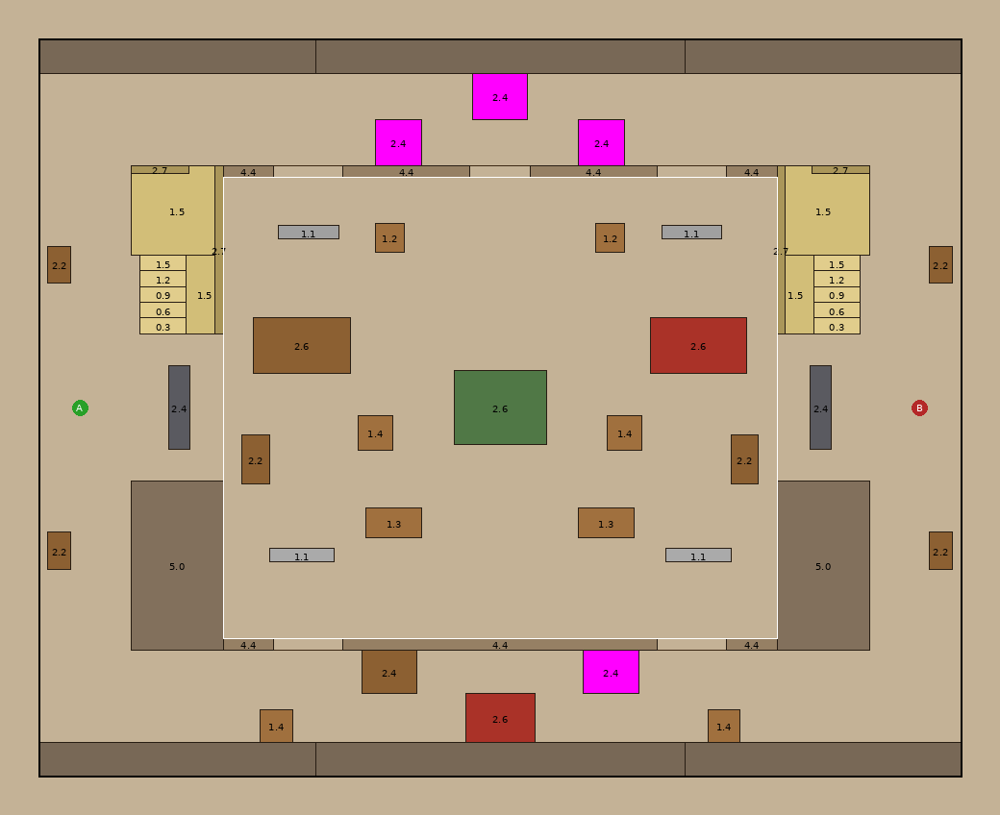
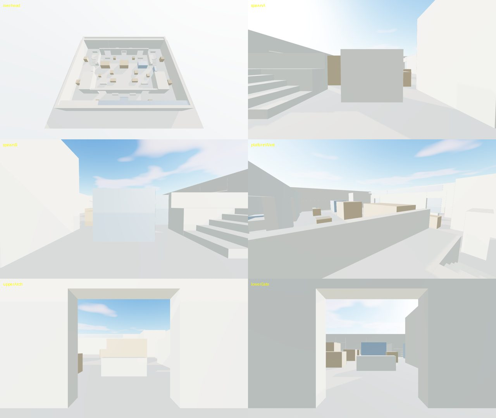
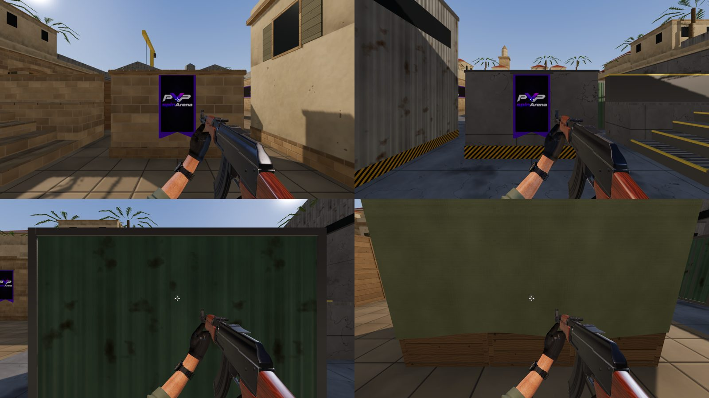
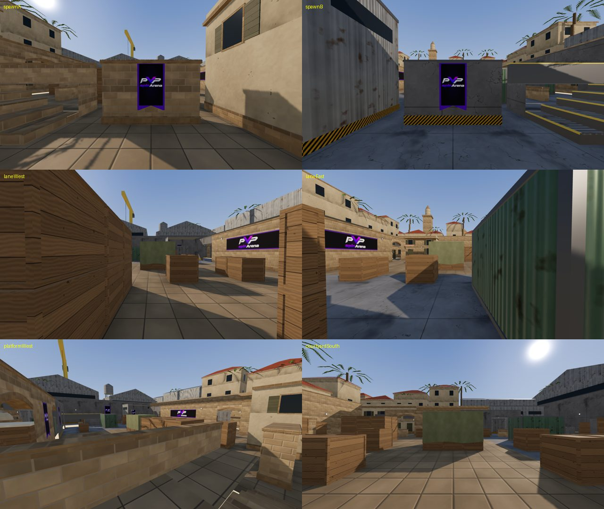
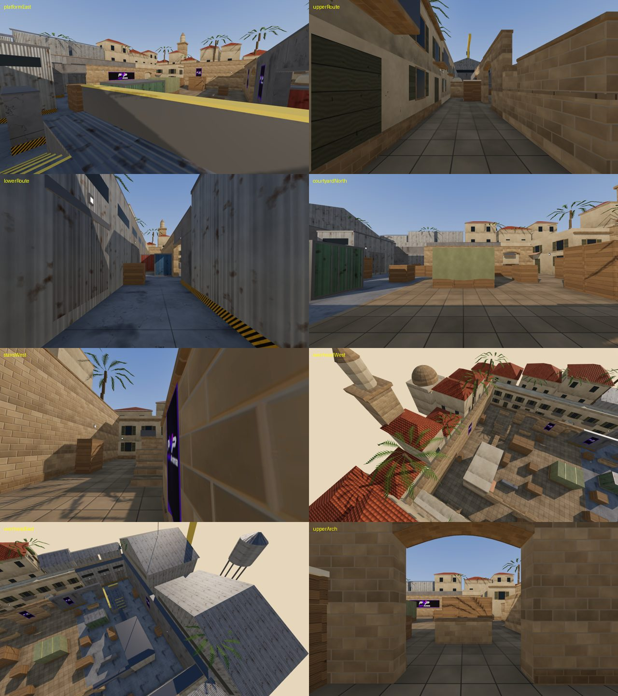

# PVPSPINARENA 1v1 aim arena: map rebuild report

Branch `fps-aim-arena`. **Not deployed.** The previous map (Foundry) is preserved at git tag
`fps-map-foundry-rollback` (commit `497bcd5`).

The work replaced the map and left the engine alone. Movement, bullets, visibility, netcode,
hitboxes, the weapon pass, the static shadow map, `compileAsync` and asset lifecycle are the
same code. The only engine change is a grounded stair step-up (`STEP_HEIGHT = 0.35 m`), which
movement needs to climb 0.3 m stairs.



## 1. What was built

- A 40 × 32 m playable arena with a 24 × 20 m courtyard and two opposed spawns: A in the west
  at (−18.2, 0) and B in the east at (18.2, 0).
- Three interconnected routes:
  - **Main aim lane:** spawn exit, then the side crate stack, then the lane between the lane
    stack and the low crate, then the centre tarp stack.
  - **Upper Mediterranean route:** the north spawn alley, then the north corridor, an S‑bend
    around the market stall and well‑house, and the arches into the courtyard.
  - **Lower industrial route:** the south alley, then the south corridor, an S‑bend around the
    crate stack and container, and the steel gates into the courtyard.
- Two elevated positions: one 1.5 m platform per side, reached by stairs, with 1.15 m parapets.
  From the platform you can drop into the alley or the corridor.
- Every gameplay solid is mirrored across x = 0. Both sides get identical cover, routes and
  timings. Only the dressing differs: Mirage-style sandstone, arches and palms in the west;
  Cache-style containers, corrugated metal and steel walkways in the east.

Source of truth: `art/blender/map/layout.py`. It generates `src/lib/fps/arena-layout.ts`, which
`map.ts` imports, and `build/layout.json`, which Blender reads. The client and the match Worker
read the same solids.

## 2. Phase order

1. **Audit and baseline.** Movement collides only with `BOXES`. Bullets and visibility trace
   `WORLD_SOLIDS`. The bot grid ignores height. `map.ts` is shared with the Worker. The old-map
   performance was recorded in `baseline-foundry-chrome.json`.
2. **Blender blockout.** Grey boxes built from the layout were exported to GLB and loaded in
   the real renderer.

   
3. **Gameplay validation** against the real simulation code (`tests/fps-arena-layout.test.ts`).
   The layout was revised from what validation found:
   - Spawn LoS through the spawn exits: widened the spawn shields and added a 2.2 m side stack.
   - First contact at 0.5 s: moved the tarp stack to the centre, which breaks the main lane.
   - 34 m corridor sightlines: added staggered S‑bend blockers.
   - Low cover raised from 1.05 to 1.15 m, so crouched players are hidden from the server
     visibility test.
   - Step-up restricted to grounded players. A jump plus a step could otherwise clear 1.2 m
     cover.
4. **Detailed environment.** Procedural PBR textures (`textures.py`) and a modular kit
   (`arena_kit.py`) dress every solid by its kind and theme.
5. **Integration.** `arena-environment.ts` shows the blockout instantly and swaps in the GLB
   when it is ready. It shares geometry and materials through `retainAuthoredAsset` and keeps
   the static shadow map, frozen matrices and per-section frustum culling. Reflections are
   re-captured after the GLB loads. The gradient sky dome and the lighting
   (`arena-lighting.ts`) are shared by the game and the capture tests.
6. **Measurement and tests** (below).

## 3. Gameplay validation (measured with the shipped movement, collision and visibility code)

| Check | Result |
|---|---|
| Spawn pad ↔ spawn pad line of sight (3.2 × 5.6 m pads, 14,400 point pairs, head, eye and chest rays) | **0 visible** |
| Route lengths from each spawn (main / upper / lower / platform) | 18.0 / 31.3 / 31.5 / 15.8 m, identical for both spawns |
| Walk time to route end (5 m/s) | main 3.6 s, upper 6.2 s, lower 6.2 s, platform 3.1 s |
| First contact, main vs main | **3.2 s walking**, 2.1 s sprinting |
| First contact, upper vs upper and lower vs lower | 4.7 s walking, 3.2 s sprinting |
| First contact, main vs upper | 3.2 s walking |
| Lower vs main or upper flank | No contact before the scripted routes end. Each player stops behind the centre stack, so they meet later in real play. |
| Longest standing sightline | 36.5 m: a diagonal from inside the spawn-A exit to the far lower gate. It does not reach the enemy spawn. |
| Courtyard floor visible from platform edge / lane entry / courtyard south | 49% / 50% / 65%. The platform is strong but not dominant, and it is visible back from the courtyard. |
| Platform ↔ platform | Mutual sightline (a long diagonal duel); neither side has it alone. |
| Openings | Every opening is ≥ 1.2 m wide for a 0.7 m player (probed with the movement code). |
| Stairs | Climbed by walking, onto the 1.5 m platform. Jumping cannot mount 1.15 m cover. |
| Bots | 0.5 m nav grid; the patrol mirrors to the bot's side and sweeps the enemy spawn exit. The solo bot room test passes. |
| Bulletproof cover | Every box stops rifle damage (wood, metal and concrete cases); there is no penetration. |

## 4. Asset statistics (`art/blender/map/build/asset-stats.json`)

| | |
|---|---|
| Shipped GLB (meshopt + quantization + GPU instancing) | **908 KB** |
| Triangles (map + background + palms) | 25,510 |
| Meshes / primitives (≈ map draw calls before culling) | 55 / 77, of which palms are 2 instanced draws for 12 trees |
| Materials / images | 27 / 26 (1K albedo and hero normals; 512 px for low-frequency maps) |
| Estimated texture GPU memory | 68 MB (with mips) |
| Coplanar same-facing overlaps (z-fighting risk) | **0** (checked at build time, and again in the browser on the decoded GLB) |
| Dressing outside its collision box (below 2.9 m) | **0 vertices** (tolerance 6 cm) |
| Surface probes on collision faces (shipped GLB, rays at 1 m) | all within 6.5 cm |

## 5. Performance before and after (headless Chrome, SwiftShader on 2 CPU cores)

The same scripted sequence runs on both maps: mount, idle, run with turning, a full 360° look,
then 4 mount/dispose cycles. This software rasteriser takes seconds per frame, so FPS and frame
times here are meaningless. Engine-side counts and load times are comparable.

| Metric | Foundry (before) | Aim arena (after) | Change |
|---|---|---|---|
| Draw calls (idle / run / 360) | 154 / 149 / 147 | **121 / 121 / 120** | −21% |
| Triangles per frame (whole scene incl. characters and weapon) | 315,279 | **267,317** | −15% |
| Shader programs | 75 | 72 | −3 |
| Geometries | 186 | 146 | −40 |
| Textures | 80 | 88 | +8 |
| Ready time per mount (lifecycle cycles) | 20.4–22.5 s | **11.3–12.1 s** | −45% |
| First mount (cold) | 42.8 s | 37.0 s | −13% |
| CPU ms per frame, p50 (idle / run / 360) | 7.2 / 6.8 / 9.4 | 4.4 / 6.2 / 6.3 | lower |
| Lifecycle drift over 4 cycles (geometries / textures / programs) | 99 / 24 / 75, stable | 59 / 32 / 72, stable | no leak |
| JS heap across cycles | 106–126 MB | 101–116 MB | similar |

Raw data: `baseline-foundry-chrome.json` and `after-aim-arena-chrome.json`. These runs cannot
tell you real-GPU frame times, behaviour on low-end hardware, or Firefox numbers. See §9.

## 6. Tests

- **Unit (vitest):** all 294 FPS tests pass. This includes:
  - the 10 new layout-validation tests
  - the cover, combat, simulation, lag-compensation and visibility tests, moved to aim-arena
    positions
  - the Durable Object runtime tests: three real-time rounds, the solo bot room, visibility
    redaction and the 30 Hz clock

  In the full suite, the only non-database failure is `architecture-opt.test.ts`, which also
  fails on `main`. The `tests/db` files need a database that this environment does not have.
- **e2e (Playwright, Chrome/SwiftShader):** results are in `e2e-results.md`. In summary:
  - Pass: surface-depth (GLB z-fighting and collision match), spawn rendering, material
    impacts, crouch, authored assets, culling (with polls long enough for software GL), and
    the perf and visual captures.
  - `fps-lifecycle` fails on a **pre-existing** 7-texture leak, which `main` has as well; it is
    not caused by the map.
  - `fps-six-rounds` was adapted to the new lane and validated in simulation, but it needs a
    real GPU to finish.

  
- `tsc --noEmit` and `eslint` are clean.

## 7. Integration notes

- `map.ts` keeps its exports (`ARENA`, `BOXES`, `WALLS`, `STRUCTURES`, `FLOOR`, `SPAWNS`,
  `WORLD_SOLIDS`). The client and the Worker build against them unchanged.
- Removed modules: `environment.ts`, `arena-architecture.ts` and `floor-polish.ts`. They are
  recoverable from the rollback tag.
- `arena-environment.ts` is not on the gameplay path. If the GLB fails, the blockout stays and
  the match plays the same.

## 8. Flicker, culling and lifecycle

- Z-fighting: there are no coplanar overlaps (build check and browser check). Trims meet end to
  end, and they tuck inside partly covered faces.
- Culling: the scene is split into nine spatial sections plus ground, perimeter, background and
  a map-wide "details" mesh, and per-mesh frustum culling stays on. Draw calls fell even with
  the added background skyline.
- Lifecycle: 4 mount/dispose cycles showed no growth in geometries, textures or programs.

## 9. Not verified here (needs your machine)

- **Firefox:** this environment cannot download a Playwright Firefox build (egress blocked).
- **Real-GPU frame times and lower-end hardware:** SwiftShader frame times are not
  representative.
- `fps-cover` "frame timing without stalls" asserts p95 < 100 ms. That only passes on a real
  GPU, and it fails the same way on `main` here.
- `fps-six-rounds` (a full bot match with real input) needs a real GPU to finish in reasonable
  time.
- Pre-existing, not the map: `fps-lifecycle` finds 7 textures left after dispose, on `main`
  as well. Worth a separate fix.

## 10. Rollback

```
git checkout fps-map-foundry-rollback -- src/lib/fps tests public/fps/models
```

Or revert the branch merge. Deploy both the app and the match Worker so the client and server
solids agree.

## 11. Deploy (only after you accept the gameplay and your own GPU check)

`git pull && npm run deploy` deploys the app and the FPS match Worker together, because
`map.ts` is shared. The client and server must not run different maps.

## 12. Rebuilding the map

```
art/blender/map/build.sh            # layout → textures → Blender (.blend + .glb) → checks → compress
art/blender/map/build.sh --blockout # grey-box version
```

Deliverables: `art/blender/map/aim-arena.blend` (textures resolve relative to `build/tex`, which
`textures.py` regenerates) and `public/fps/models/aim-arena.glb`.

## 13. Known limits and follow-ups

- The arch lintel collision starts at the 3.2 m springing line. The visible arch rises up to
  0.35 m above that at its apex, so a bullet aimed into the top of an arch is stopped slightly
  early. This is well above any head (1.8 m standing, 2.7 m jumping).
- Small dome and canopy tops sit above their solids' collision tops. They only hide space the
  solid already hides.
- Textures are procedural, not scanned. A material pass with photo-sourced textures would lift
  close-up fidelity further, at a texture-memory cost.



