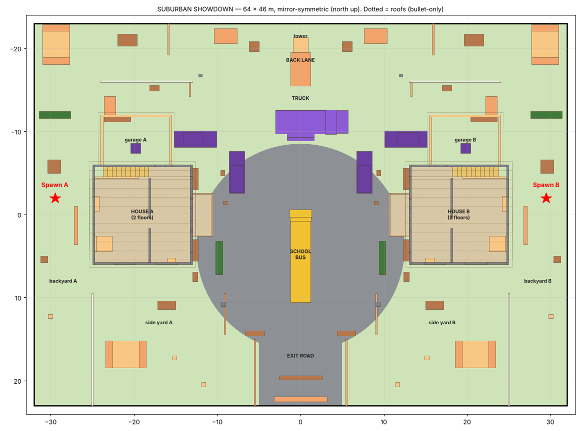
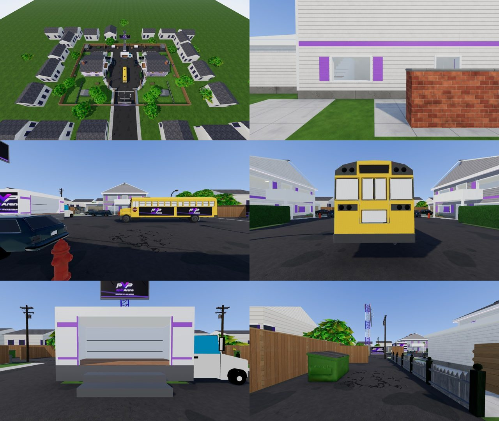
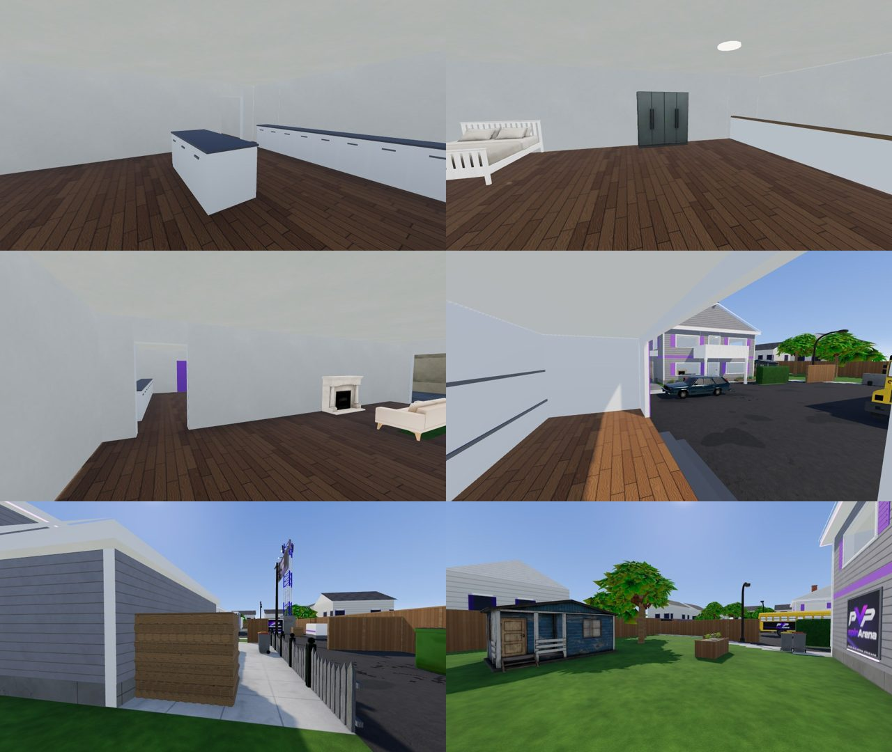

# SUBURBAN SHOWDOWN — map 05 (PVPSPINARENA suburb)

Branch `fps-map-suburbia` (not merged, not deployed). SUBURBAN SHOWDOWN is the fifth 1v1 map: a
Nuketown-style cul-de-sac — two two-storey houses facing each other across a curved street, with
a school bus and a delivery truck in the middle, garages, side yards, a side passage and a back
lane — dressed in the PVPSPINARENA violet. It is built on the shared map pack
(`docs/FPS-SHARED-MAP-PACK.md`, `docs/FPS-MAP-REGISTRY.md`) and registered with `rotation: true`,
so once merged and deployed every new Practice and PvP match draws from Dustfront, FROSTLINE,
LOST TRAIL, CROSSFIRE and SUBURBAN SHOWDOWN.

Shared files touched, each through a documented registry extension point:

- `maps/catalog.ts`: one import and one entry.
- `maps/loading-screens.ts`: one import and one art entry (the owner-supplied render).
- `tests/fps-map-dustfront-parity.test.ts`: the `MAP_IDS` and `ROTATION_MAP_IDS` lines.
- `tests/e2e/fps-entry-loading.spec.ts`: the map-name → art table.
- `public/fps/models/ATTRIBUTION.md`: the Sketchfab credits.
- `docs/FPS-SHARED-MAP-PACK.md`: one sentence on its footstep surfaces.

The simulation, renderer, networking, match admission, characters, weapons, audio, practice bot
and the other four maps are untouched. SUBURBAN SHOWDOWN needs no environment factory, so it uses
the shared loader as Dustfront does.

## 1. Files

| File                                                                 | What it is                                                                                                                                                                                                                                                                            |
| -------------------------------------------------------------------- | ------------------------------------------------------------------------------------------------------------------------------------------------------------------------------------------------------------------------------------------------------------------------------------- |
| `art/blender/suburbia/layout.py`                                     | Source of truth for the gameplay solids → `build/layout.json` and `src/lib/fps/suburbia-layout.ts`.                                                                                                                                                                                   |
| `art/blender/suburbia/textures.py`                                   | Procedural textures: the shared Dustfront / CROSSFIRE generators (imported) plus siding, shingles, lawn, hedge, fence boards, floorboards, interior paint, sidewalk, residential asphalt, the violet PVPSPINARENA wraps, billboard and monument sign, distant facades, ground decals. |
| `art/blender/suburbia/suburbia_kit.py`                               | The suburban environment kit on top of the shared kit (`../map/arena_kit.py`, imported, not copied): houses, garages, yards, street, perimeter, neighbourhood.                                                                                                                        |
| `art/blender/suburbia/props.py`                                      | Places the Sketchfab models on their gameplay solids, validates them against the collision.                                                                                                                                                                                           |
| `art/blender/suburbia/build_suburbia.py`                             | Blender build: culling sections, one mesh per material per section, GLB export, `.blend`.                                                                                                                                                                                             |
| `art/blender/suburbia/build.sh`                                      | Pipeline: layout → textures → Blender → `check_glb.py` → GPU instancing → meshopt.                                                                                                                                                                                                    |
| `art/blender/suburbia/suburbia.blend`                                | The built scene, one collection per culling section.                                                                                                                                                                                                                                  |
| `art/blender/suburbia/source/`                                       | The prepared Sketchfab models (`*.glb`), their licence files and `README.md`.                                                                                                                                                                                                         |
| `art/blender/suburbia/tools/prep_sources.py`                         | Prepares the Sketchfab downloads into `source/` (trim, frame, decimate, textures).                                                                                                                                                                                                    |
| `art/blender/suburbia/tools/inspect_sources.py`, `render_sources.py` | Measure / render the downloads (used to fit the collision).                                                                                                                                                                                                                           |
| `art/blender/suburbia/render_views.py`, `plot_layout.py`             | Review renders of the `.blend`; the top-down plot above.                                                                                                                                                                                                                              |
| `src/lib/fps/maps/suburbia.ts`                                       | The `MapDefinition`: solids, spawns, footsteps, bot routes, presentation.                                                                                                                                                                                                             |
| `src/lib/fps/suburbia-layout.ts`                                     | Generated gameplay solids.                                                                                                                                                                                                                                                            |
| `public/fps/models/suburbia.glb`                                     | The shipped scene (meshopt, GPU instancing).                                                                                                                                                                                                                                          |
| `src/assets/fps/suburbia-loading.webp`                               | Loading art (the owner's branded render).                                                                                                                                                                                                                                             |
| `tests/fps-suburbia-layout.test.ts`                                  | Gameplay validation with the real movement, collision, visibility and bot code.                                                                                                                                                                                                       |
| `tests/e2e/fps-suburbia.spec.ts`                                     | Browser checks of the shipped GLB, map switching and loading art.                                                                                                                                                                                                                     |
| `scripts/fps/map-capture/suburbia.views.json`                        | First-person capture views for the shared capture tool.                                                                                                                                                                                                                               |

## 2. Layout (64 × 46 m)

Mirror-symmetric across the street (x = 0): every solid at x has an identical twin at −x, so
both spawns have the same cover, routes and timings while the houses are dressed differently
(A white with violet trim, B charcoal with violet trim). The truck's cab is the one unmirrored
part (small, north of the street, off both spawns' routes).

- **Backyards / spawns** (x ±25..±32): lawn, patio, picnic table, brick BBQ, a brick garden
  wall shielding the back door, a hedge, a tree; a gate to the side yard.
- **Houses** (x ±13..±25, z −6..6): two floors (upper floor at 3 m). Ground floor: kitchen
  (back, with the stairs, island and counter) and living room (front, sofa and fireplace),
  split by a full-height wall whose single doorway is offset so no straight line runs from a
  back opening out of a front one. Front door and two big windows to the street, back door and
  window to the backyard. Upstairs: bedroom (bed, wardrobe) and front room (dresser) with
  street windows and a door onto the front balcony (the porch roof, on two posts, solid
  railing = crouch cover); side-yard windows. Roof, gables and chimney out of reach.
- **Garages** (north of each house): open door to the driveway, inner door to the living
  room, workbench, boxes; a car on each driveway.
- **Side yards** (south): picket and privacy fences, a shed, a raised planter, trees, wheelie
  bins; a privacy fence on the street edge so yard and street don't see across.
- **Side passage** (north of each garage): a dog-leg between a woodpile and a gate panel, so
  it never gives a straight look from the backyard to the street.
- **Back lane** (z −16..−23, shared): dumpsters, sheds, utility poles, crates, a trailer, lane
  fences, and the billboard tower with a branded storage container that splits the 64 m lane.
- **Cul-de-sac**: the school bus lengthwise across the centre (solid cover), the delivery
  truck to the north (cab east, an enterable PVPSPINARENA cargo box with an open side door and
  steps up to its 0.9 m floor), station wagons parked on the ring, jersey barriers, the exit
  road south with a barricade and the PVPSPINARENA monument sign; street lamps, hydrants, mail
  boxes, shrub beds under the front windows, tall hedges on the front lawns.
- **Perimeter**: the neighbours' 2.4 m board fences (also the perimeter collision), with a
  branded hoarding where the exit road leaves the block.

Bot routes (east-spawn coordinates, mirrored for the west spawn): centre (side yard → round
the bus → the enemy side yard), north (the side passage → north of the truck → the enemy
passage), south (side yard → south of the bus). The houses' interiors are under the upper
floor, so the bot's ground grid routes round them; human players use every interior route.

### Validation (real movement, collision and visibility code)

`tests/fps-suburbia-layout.test.ts` (SUBURBIA METRICS):

| Check                                                                   | Result                                                                                                                 |
| ----------------------------------------------------------------------- | ---------------------------------------------------------------------------------------------------------------------- |
| Mirror symmetry                                                         | every solid has an identical twin at −x (the truck's cab + bonnet excepted, 13 m³, off both routes)                    |
| Spawn pads (3.2 × 4.8 m each): pairs of points that see each other      | **0 of 13,689**                                                                                                        |
| Routes walked with the real movement code (spawn A; B walks the mirror) | interior 29.8 m / 5.9 s, upstairs to the balcony 32.2 m / 6.3 s, side yard 28.8 m / 5.7 s, side passage 36.1 m / 7.2 s |
| Stairs                                                                  | reach the upper floor at 3.0 m (0.3 m risers, step height 0.35 m)                                                      |
| Truck                                                                   | cargo bay reachable up its steps (floor 0.9 m)                                                                         |
| Bus                                                                     | solid from bonnet to tail at 0.5, 1.6 and 2.6 m                                                                        |
| First contact (walking, 9 route pairs)                                  | 3.9–9.2 s (sprinting 2.6–7.5 s)                                                                                        |
| Front balcony                                                           | sees 65 % of the street cells, neither spawn                                                                           |
| Longest open sightline at eye height                                    | 57.6 m (corner to corner across the side yards and the lane)                                                           |
| Practice-bot routes                                                     | every point reachable on the bot's ground grid from spawn B (6,665 of 6,863 cells)                                     |
| Practice-bot reveal for an idle player (shared test, 20 s bound)        | worst patrol 18.3 s (push 8.8–9.5 s)                                                                                   |
| Server reveal (redaction)                                               | the houses hide the spawns from each other                                                                             |

## 3. Blender construction

**Procedural (project work, `suburbia_kit.py`)**: both houses (lap siding on a concrete
foundation, violet floor-line band, white trim and corner boards, violet louvred shutters,
open windows with casings and sills, shuttered windows on solid walls, violet doors, a
shingled pitched roof with gables, fascia and soffits, a violet LED strip under the eaves, a
brick chimney; inside: oak floors, painted walls and ceilings, ceiling lights, stairs, a
balustrade, kitchen island and counter, door leaves), the garages, porch and balcony, hedges,
mulch beds, privacy and perimeter fences, garden wall, BBQ, woodpile, planter, tree trunks,
the truck's PVPSPINARENA cargo box, the storage container, the trailer, crates, jersey
barriers, the monument sign, the transmitter hut and billboard, the PVPSPINARENA logo panels
on the side walls and banners on the back fences, the ground (asphalt, sidewalks, driveways,
lawns, floors) with baked AO, road paint and decals, and the neighbourhood beyond the fences.

**Sketchfab models (CC BY 4.0, `props.py`)**: school bus, truck cab and chassis, three cars,
picket fence, sheds, utility poles, mail boxes, picnic tables, the radio tower, oak trees,
shrubs, wheelie bins, dumpsters, street lamps, hydrants, cardboard boxes, road signs and the
interior furniture. Each is placed onto the gameplay solids that describe it (position, facing
and uniform scale from the solid); the collision was fitted to each model's measured shape
(cars: body + glasshouse; bus: bonnet, front, body; sheds: walls + ridge; the bed: frame +
headboard).

Rules (as every map): below 2.9 m above any walkable floor (ground, upper floors, balconies),
every vertex of the kit and of every model lies within 6 cm of a gameplay solid (no invisible
walls, no visual-only cover; ground detail ≤ 13 cm excepted) — `VALIDATE` and `PROPS VALIDATE`
report 0; no coplanar overlaps in the project's meshes (`check_glb.py`, gated in `build.sh`;
the bus, tower and truck cab carry a few internal overlaps of their own that are not visible).

### Asset statistics

|                                                                                     | Dustfront    | CROSSFIRE    | SUBURBAN SHOWDOWN                                                                                                                                                                                           |
| ----------------------------------------------------------------------------------- | ------------ | ------------ | ----------------------------------------------------------------------------------------------------------------------------------------------------------------------------------------------------------- |
| Shipped GLB                                                                         | 908 KB       | 1.76 MB      | 3.62 MB                                                                                                                                                                                                     |
| Triangles (map, incl. instances)                                                    | 25,510       | 51,630       | 154,492 (vehicles 41k, street/yard props 32k, ground 23k, trees 22k, kit 19k, picket fences 10k, furniture 7k)                                                                                              |
| Draw primitives before culling / culling sections                                   | 77 / 13      | 76 / 13      | 137 meshes (55 GPU-instanced, 206 instances) / 10                                                                                                                                                           |
| Materials / images                                                                  | 27 / 26      | 28 / 42      | 101 / 116 (the models bring their own; kit colours in tint families)                                                                                                                                        |
| Texture megapixels / est. GPU memory                                                | 13.4 / 68 MB | 19.1 / 97 MB | 26.3 / 134 MB                                                                                                                                                                                               |
| Coplanar overlaps in project meshes (build, and browser after quantisation)         | 0            | 0            | **0**                                                                                                                                                                                                       |
| Dressing outside its collision (kit and models, within 2.9 m of any walkable floor) | 0            | 0            | **0**                                                                                                                                                                                                       |
| Browser collision-face probes (rays at 1 m)                                         | all ≤ 6.5 cm | 265          | **425**: 262 procedural boxes all ≤ 6.5 cm; 163 boxes fitted round a model / trunk / log stack: never outside, median 3 cm inside, worst 36 cm inside (car bonnets, bus nose, see-through table and fences) |
| Gameplay solids                                                                     | —            | 191 + 4      | 243 boxes + 14 bullet-only (roofs) + 4 perimeter fences                                                                                                                                                     |

## 4. Shared systems reused

Everything shared is reused unchanged; nothing is duplicated.

| Shared system                                                                                                                                      | SUBURBAN SHOWDOWN                                                     |
| -------------------------------------------------------------------------------------------------------------------------------------------------- | --------------------------------------------------------------------- |
| Map registry (`compileMap`, `catalog.ts`, rotation)                                                                                                | Reused: one definition, one catalog entry                             |
| AABB collision shared by client and server, hitscan, line of sight, server redaction                                                               | Reused with the map's solids                                          |
| Networking, match Worker, admission                                                                                                                | Reused unchanged (the Worker bundles the catalog: 273 KiB, no images) |
| Characters, weapons, viewmodels, audio                                                                                                             | Reused unchanged                                                      |
| Practice bot (ground grid, routes)                                                                                                                 | Reused; the map supplies its routes                                   |
| Shared loader (`arena-environment.ts`): sky, blockout until the GLB, static shadow map, one-time reflections, frozen matrices, per-section culling | Reused (no environment factory)                                       |
| Adaptive render budget, shader warm-up before Ready                                                                                                | Reused                                                                |
| Kit primitives, buckets, hidden-face removal, baked AO, validation (`arena_kit.py`)                                                                | Reused (imported)                                                     |
| Tint families (one material per family, colour in vertex colours)                                                                                  | Adapted: siding, interior, paint                                      |
| Texture generators (Dustfront, CROSSFIRE)                                                                                                          | Reused (imported)                                                     |
| Pipeline: `check_glb.py`, `gltf-transform instance` + `meshopt`                                                                                    | Reused                                                                |
| Loading screen and art warming                                                                                                                     | Reused: one art entry                                                 |
| Map capture tool (`scripts/fps/map-capture`)                                                                                                       | Reused: a views file                                                  |

## 5. Performance

Measured with the shared capture tool (`scripts/fps/map-capture/capture.mjs`: the game's own map
loader and lighting, first-person views, players not drawn) in headless Chromium on SwiftShader
(software rendering), all four maps in one session, nothing else running. Frame times on
software rendering are seconds and only the ratios carry over to a GPU. Dustfront, CROSSFIRE
and LOST TRAIL use their standard views (`compare-48x40.views.json`: both spawns, north, south);
SUBURBAN SHOWDOWN uses `suburbia.views.json` (spawns, porches, street, truck, living room,
balcony, lane, side yard).

| Map (player-height views) | Draw calls | Triangles | Software frame (min – max, median) | vs Dustfront (median)                       | Load   |
| ------------------------- | ---------- | --------- | ---------------------------------- | ------------------------------------------- | ------ |
| Dustfront                 | 54–56      | 26k       | 1.09–1.21 s, 1.17 s                | 1×                                          | 161 ms |
| CROSSFIRE                 | 61–63      | 52k       | 1.17–1.36 s, 1.31 s                | 1.12×                                       | 258 ms |
| **SUBURBAN SHOWDOWN**     | 71–143     | 100–166k  | 0.80–1.73 s, 1.23 s                | **1.05×** (worst view 1.48×, at the spawns) | 450 ms |
| LOST TRAIL                | 156–162    | 257k      | 3.43–3.75 s, 3.72 s                | 3.2×                                        | 341 ms |

SUBURBAN SHOWDOWN costs about what CROSSFIRE does per frame on the median view; its spawn views
(which see the whole street and both houses' roofs) are the heaviest, at about 1.5× Dustfront,
still less than half of LOST TRAIL. It draws more calls than the older maps because its props
are separate models (each with a few materials), partly offset by GPU instancing (55 instanced
meshes, 206 instances) and section culling.

Optimisations applied to reach this (first build → shipped): background oaks swapped for a 570-
triangle version and halved in number (+ crown-only canopies over the playable trees),
decimation of the cars, bus, pickets, poles, bushes and props, the cars' small materials merged
into four shared ones, every model reduced to its base-colour texture (normal / roughness /
emissive maps dropped, except the shed's) at 256–512 px (bus 1024), half-resolution kit
textures for the low-frequency maps: 583k → 154k triangles, 70.9 → 26.3 megapixels, 340 → 288
primitives, 14 MB → 3.6 MB shipped.

The full-game sequence (`tests/e2e/fps-frostline-perf.spec.ts`, renderer with operators and
weapons) did not finish on this session's software renderer (Dustfront alone exceeded its
15-minute budget), so full-game and real-GPU numbers are not measured here; the procedure is in
`docs/fps-map/FROSTLINE.md` §6 with `MAP_PERF_MAPS=dustfront,suburbia`.

**Pipeline fix found on the way:** quantising after GPU instancing (`instance` → `meshopt`, as
the other maps' `build.sh` do) misplaces and rescales instanced meshes in three.js (checked in
the browser: instance bounds 1.6–5× too large and offset). SUBURBAN SHOWDOWN quantises first
(`quantize` → `instance` → `meshopt`), verified correct in the browser. The other maps' instanced
meshes (CROSSFIRE's palms, for instance) may show the same issue; not changed here.

## 6. Integration status

**Done on this branch**

- Registered: `getMap("suburbia")` resolves on the client and in the match Worker, and it is in
  the rotation.
- Loading screen: its art and name through the shared loading screen; its art is warmed with the
  other rotation maps'.
- Verification: FPS unit tests (`tests/fps-*.test.ts`) 644 pass / 1 skipped; `tsc` clean;
  browser spec `tests/e2e/fps-suburbia.spec.ts` — GLB check (0 overlaps, 425 probes, 0 misses)
  and loading art pass; the match Worker dry-run build passes (273 KiB, includes the map, no
  images).
- Not completed here: the spec's Dustfront ↔ SUBURBAN SHOWDOWN map-switching test (five full
  renderer mounts) exceeded 45 minutes on this session's software renderer, as did the
  full-game performance sequence for Dustfront alone; both need a faster machine or a GPU.

**Before merging / deploying (needs the owner's authorization)**

- Deploy the match Worker only together with (or after) an app that knows SUBURBAN SHOWDOWN:
  the server draws the map, so an old client would be sent a map it cannot load.
- Real-GPU frame times are not measured here (software rendering only); the procedure is in
  `docs/fps-map/FROSTLINE.md` §6 with `MAP_PERF_MAPS=dustfront,suburbia`.

## 7. Credits, limitations and risks

- **Credits:** every Sketchfab model is CC BY 4.0, credited in `public/fps/models/ATTRIBUTION.md`
  and `art/blender/suburbia/source/README.md` (title, author, link, licence, changes). No CC BY-NC
  / CC BY-SA model is used; no file carries Call of Duty / Nuketown asset names. The loading art
  was supplied by the owner.
- **Bus:** solid cover (its windows are painted on the model, so they are not see-through).
- **Windows:** the houses' windows are open (no glass): they are see-through and shoot-through,
  matching their collision.
- **Interiors and the bot:** the practice bot does not enter the houses (its grid is 2D); it
  patrols the yards, passage, lane and street.
- **Third-party look:** the models come from several authors and styles (the oak tree is
  stylised); the oak canopies over the playable trees use only the model's upper crown so the
  leaves start above reach.
- **Cost:** heavier than Dustfront / CROSSFIRE in draw calls and triangles (more props, a
  larger map), still well under LOST TRAIL; see §5.
